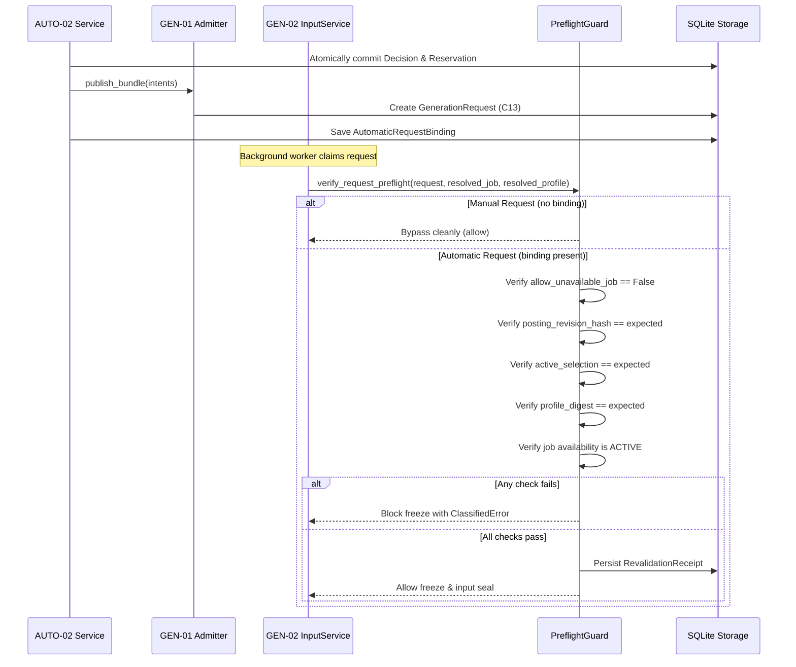

# Component Handoff: AUTO-02 — Automatic Drafting Policy, Limits, and Deduplication

Component ID: **AUTO-02**  
Status: **VERIFIED (Unit, Integration, Seam Guard, Service, CLI, and Acceptance Matrix)**  
Phase: **Phase 2 (Automation & Supervision)**  
Baseline: [IMPLEMENTATION_BLUEPRINT.md](../../IMPLEMENTATION_BLUEPRINT.md) (v1.0, 26 October 2026), §§3–10, Phase 2, Gate G5; [docs/stories/AUTO-02.md](../stories/AUTO-02.md)  
Prerequisite Handoffs:
- [MATCH-02](MATCH-02.md) (**VERIFIED**)
- [GEN-01](GEN-01.md) (**VERIFIED**)
- [GEN-02](GEN-02.md) (**VERIFIED**)
- [GEN-03](GEN-03.md) (**VERIFIED**)
- [GEN-04](GEN-04.md) (**VERIFIED**)
- [GEN-05](GEN-05.md) (**VERIFIED**)
- [GEN-06](GEN-06.md) (**VERIFIED**)
- [AUTO-01](AUTO-01.md) (**VERIFIED**)  
Date Completed: 31 October 2026  
Direct Covered Requirements: [R17](../../IMPLEMENTATION_BLUEPRINT.md#r17) (Deterministic automation without autonomous approval/submission), [R05](../../IMPLEMENTATION_BLUEPRINT.md#r05)–[R06](../../IMPLEMENTATION_BLUEPRINT.md#r06) / [R09](../../IMPLEMENTATION_BLUEPRINT.md#r09)–[R12](../../IMPLEMENTATION_BLUEPRINT.md#r12) (Draft generation request lifecycle and boundaries), [R14](../../IMPLEMENTATION_BLUEPRINT.md#r14)–[R16](../../IMPLEMENTATION_BLUEPRINT.md#r16) (Native Windows runtime, process locking, and diagnostic privacy)

---

## 1. Executive Summary & Component Scope

`AUTO-02` implements the bounded, explicit policy, quota, and deduplication engine that governs when candidate jobs may be automatically admitted into the generation pipeline (`GEN-01`).

It serves as the critical safety bridge between search/match assessment (`MATCH-02`) and draft document creation (`GEN-01` through `GEN-06`).

### Non-Negotiable Core Principles & Invariants
1. **Strictly Opt-In Automation**:
   - Automation is disabled by default (`enabled: false`).
   - If disabled or misconfigured, every evaluation run terminates immediately with zero admissions, zero reservations, and zero mutations.
2. **No Candidate-Approved Thresholds**:
   - The system **never** invents "candidate-approved" threshold heuristics.
   - Evaluator decisions strictly respect authoritative assessment selection, minimum relevance score thresholds, explicit candidate opt-out, and active posting availability.
3. **No Automated Application Submission or Document Approval**:
   - All requests admitted by `AUTO-02` result exclusively in documents created with approval status `draft`.
   - Under no circumstances does `AUTO-02` submit an application to an employer, send an email, upload files externally, or transition documents out of `draft`.
4. **Dual-Fingerprint Request Identity**:
   - Policy decisions and material generation work are separated into two distinct fingerprints:
     - **Decision-Input Fingerprint**: Explains *why* a job was admitted or held (capturing policy version, match score, rule coverage, and identified unknowns).
     - **Material Generation Fingerprint**: Identifies *equivalent generation work* across runs (excluding policy version, score, attempt UUIDs, and timestamps).
5. **Atomic Document Variant Bundling**:
   - When a policy configures multiple document variants (e.g. CV + Cover Letter = 2 logical document units), the entire bundle is evaluated atomically against volume quotas. If insufficient quota remains for the full bundle, the candidate is deferred entirely (`DEFERRED`) to prevent orphan single-document generations.
6. **Preflight Freeze Guard at GEN-01/GEN-02 Seam**:
   - Binds automatic request admission directly to input freeze (`prepare_freeze`).
   - Re-verifies posting revisions, active assessment selection, candidate profile digests, and availability before claim/freeze. Any drift immediately aborts the draft request with a structured error, recording a durable revalidation receipt.
7. **Windows Native Conventions**:
   - Fully supports Windows filesystem paths with spaces and German umlauts (e.g., `Bewerbung München & Zürich`).
   - Concurrency is protected by the cross-component exclusive lock (`WindowsWorkerLock`).

---

## 2. Traceability & Contracts Implemented

### 2.1 Contracts Implemented (`job_automation.generation.automatic.records`)

| Contract Record | Version | Status | Purpose |
|---|---|---|---|
| `AutomaticDraftPolicy` | 1.0 | **VERIFIED** | Active automatic drafting policy (enabled flag, min score, document variants, volume limits, repeat policy, content hash). |
| `AutomaticDraftCandidate` | 1.0 | **VERIFIED** | Authoritative candidate envelope combining C07 CanonicalJob, C08 Assessment, C03 Profile, and Candidate Control evidence. |
| `AutomaticDraftDecision` | 1.0 | **VERIFIED** | Durable audit record explaining an admission, deferral, hold, or exclusion with rule codes and quota snapshot. |
| `AutomaticDraftIntent` | 1.0 | **VERIFIED** | Durable queue intent representing an intention to publish an automatic draft request. |
| `AutomaticDraftReservation` | 1.0 | **VERIFIED** | Atomic volume reservation tracking allocated document units against run, window, outstanding, and per-job limits. |
| `AutomaticRequestBinding` | 1.0 | **VERIFIED** | Seam contract binding an admitted C13 `GenerationRequest` to its expected input digests, verified by the preflight guard. |
| `AutomaticDraftEvaluationReport`| 1.0 | **VERIFIED** | Inspectable report summarizing candidate evaluations, outcome breakdowns, quota utilization, and error diagnostics. |
| `DocumentVariantConfig` | 1.0 | **VERIFIED** | Per-variant generation options (document type, target language, template ID, context strategy, output formats). |
| `AutomaticVolumeLimits` | 1.0 | **VERIFIED** | Configurable volume budget limits (`max_requests_per_run`, `max_requests_per_window`, `max_outstanding_requests`, `max_requests_per_job`). |
| `RepeatPolicy` | 1.0 | **VERIFIED** | Rules governing repeated drafting (`FIRST_ONLY` vs `ON_MATERIAL_CHANGE`, cooldown hours). |

JSON schemas for all lifecycle records are published under `schemas/v1/` and verified in contract catalog tests.

### 2.2 Storage Migration 017 (`MIGRATION_017_AUTOMATIC_DRAFT_POLICY_AND_HISTORY`)

Registered in `ALL_MIGRATIONS` with atomic transaction and SHA-256 checksum verification:
- `auto_draft_policies`: Policy definitions with versioning and SHA-256 content hashes.
- `auto_draft_decisions`: Point-in-time evaluation decisions with decision-input fingerprints and quota snapshots.
- `auto_draft_intents`: Durable intent records indexed by `client_request_key` and `material_generation_fingerprint`.
- `auto_draft_reservations`: Atomic volume quota reservations with status (`ACTIVE`, `RELEASED`) and window indexes.
- `auto_draft_request_bindings`: Bindings linking local `GenerationRequest` IDs to intents and expected evidence digests, with durable revalidation receipts.

---

## 3. Ordered Eligibility Gates (Gates 1–11)

The evaluation engine (`AutomaticDraftEvaluator`) applies an immutable, fail-closed decision table. Evaluation stops at the first failing gate:

| Gate | Name | Condition Checked | Failure Outcome | Primary Reason Code |
|---|---|---|---|---|
| **Gate 1** | Policy Enabled | `policy.enabled is True` | `EXCLUDED` | `policy_disabled` |
| **Gate 2** | Organization Scope | `candidate.salesforce_org_id == policy.salesforce_org_id` | `EXCLUDED` | `org_mismatch` |
| **Gate 3** | Candidate Scope | `candidate.candidate_id == policy.candidate_id` | `EXCLUDED` | `candidate_mismatch` |
| **Gate 4** | Evidence Completeness | No clock skew, no identified unknowns, validation issues empty | `REVIEW_REQUIRED` | `evidence_incomplete` / `assessment_future_clock_skew` |
| **Gate 5** | Rule Coverage | `rule_coverage_complete is True` | `REVIEW_REQUIRED` | `rule_coverage_incomplete` |
| **Gate 6** | Authoritative Selection | `is_authoritative_selection is True` | `REVIEW_REQUIRED` | `selection_not_authoritative` |
| **Gate 7** | Assessment Disposition | `assessment_disposition == ELIGIBLE` | `INELIGIBLE` | `disposition_not_eligible` |
| **Gate 8** | Relevance Score | `relevance_score >= policy.minimum_relevance_score` | `INELIGIBLE` | `score_below_threshold` |
| **Gate 9** | Job Availability | `availability_status == ACTIVE` | `INELIGIBLE` / `REVIEW_REQUIRED` | `job_unavailable` / `availability_uncertain` |
| **Gate 10** | Application State | `candidate_application_state in ("New", "Reviewed")` | `EXCLUDED` | `application_already_advanced` |
| **Gate 11** | Candidate Opt-Out | `candidate_opted_out is False` | `SUPPRESSED` | `candidate_opted_out` |

If all 11 gates pass, the candidate qualifies with preliminary outcome `ADMITTED`.

---

## 4. Request Identity, Two Fingerprints, and Deduplication

### 4.1 Two-Fingerprint Separation
1. **Decision-Input Fingerprint**:
   - `compute_decision_input_fingerprint(candidate, policy)`
   - Explains *why* the job was evaluated as admitted or held. Includes policy version, policy hash, relevance score, rule coverage, and assessment ID.
   - Used for audit trail in `auto_draft_decisions`.
2. **Material Generation Fingerprint**:
   - `compute_material_generation_fingerprint(candidate, variant)`
   - Identifies the *essential drafting inputs* (org ID, candidate ID, canonical job ID, normalized posting hash, profile version & digest, document type, language, template ID, context strategy, formats).
   - **Excludes**: policy versions, timestamps, attempt UUIDs, relevance scores.
   - Binds duplicate detection across days and across policy revisions.

### 4.2 Deterministic Client Request Keys
- `derive_automatic_client_request_key(material_fingerprint, ...)`
- Format: `auto02:v1:<sha256-hex>`
- Sibling requests in a bundle (e.g. CV vs Cover Letter) produce **distinct client keys** because document type is factored into the fingerprint.
- If an admission crash occurs after reservation, the key ensures idempotent re-issuance without duplicate work.

### 4.3 Repeat Policy & Deduplication Rules
- **Exact Input Match Across Runs**: If an intent with the identical material fingerprint already exists:
  - If identical inputs were previously drafted: outcome is `REUSED` (`already_drafted_identical_inputs`).
  - If inputs changed and subsequently reverted to a historical version: outcome is `REUSED` (`historical_input_reversion_reused`).
- **Repeat Policies**:
  - `FIRST_ONLY`: If prior drafts exist for this job/type, new runs are `SUPPRESSED` (`first_only_already_drafted`).
  - `ON_MATERIAL_CHANGE`: Only admits if material inputs changed; enforces configured `cooldown_hours` (`repeat_cooldown_active`).
- **Interaction with Manual Requests**:
  - If an existing claimed/frozen manual request matches posting and profile versions: automatic drafting is `SUPPRESSED` (`matching_manual_request_exists`).
  - If an unsealed pending manual request exists on the job: automatic drafting is held in `REVIEW_REQUIRED` (`ambiguous_pending_manual_request`).
  - **Explicit Manual Regeneration**: Manual generation requests (with fresh UUIDs and predecessor pointers) are **never** suppressed or blocked by `AUTO-02`.

---

## 5. Volume Limits and Atomic Bundling

### 5.1 Quota Accounting in Logical Document Units
Volume is budgeted in logical document units:
$$\text{Units} = \sum_{\text{candidate}} |\text{policy.document\_variants}|$$
- A bundle with CV + Cover Letter consumes 2 units.
- 4 limits are evaluated by `BudgetManager`:
  1. `max_requests_per_run`: Max units admitted in a single execution cycle.
  2. `max_requests_per_window`: Rolling window limit (default 24 hours).
  3. `max_outstanding_requests`: Active reservations plus uncompleted generation requests.
  4. `max_requests_per_job`: Total historical drafts allowed for a single job.

### 5.2 Atomic Bundle Deferral
If a candidate qualifies for 2 document variants but only 1 unit remains in run or window quota, the candidate is **deferred as a whole** (`DEFERRED`, reason `volume_quota_exhausted`). Partial application sets are strictly prevented.

### 5.3 Deterministic Ranking
Candidates are sorted deterministically before quota allocation:
1. Relevance score descending (highest priority first).
2. Canonical job UUID ascending (stable tie-breaker).

---

## 6. Preflight Freeze Guard (GEN-01 / GEN-02 Seam)

Located in `src/job_automation/generation/automatic/preflight.py` and integrated into `DefaultGenerationInputService.prepare_freeze`:

---

## 7. CLI Subcommands and Safe Reporting

### 7.1 CLI Commands (`job_automation auto-draft`)
- `python -m job_automation auto-draft evaluate [--policy <path>] [--preview] [--json]`
  - Runs bounded evaluation cycle.
  - `--preview`: Zero database writes; computes decisions and volume feasibility safely.
  - `--json`: Machine-readable output for programmatic inspection.
- `python -m job_automation auto-draft show [--job-id <uuid>] [--run-id <uuid>]`
  - Displays recorded decisions, intents, and quota reservations.

### 7.2 Diagnostic Privacy
Evaluation reports format safe summaries that never disclose candidate facts, resume content, or LLM prompt text in logs or console output.

---

## 8. Verification & Acceptance Matrix

The component has been verified against the acceptance matrix in `docs/stories/AUTO-02.md`:

| Test ID | Scenario | Verification Method | Result |
|---|---|---|---|
| **A02-T01** | First eligible result meeting threshold admits C13 request | `test_a02_t01_first_successful_eligible_result` | **PASS** |
| **A02-T02** | Repeat evaluation on next day reuses existing draft without duplicate | `test_a02_t02_repeat_unchanged_evaluation_on_another_day` | **PASS** |
| **A02-T03** | Single-worker lock contention defers execution safely | `test_a02_t03_single_worker_lock_contention_defers` | **PASS** |
| **A02-T04** | Atomic bundle deferral when volume quota is partially exhausted | `test_a02_t04_bundle_volume_limit_atomic_deferral` | **PASS** |
| **A02-T05** | Reconciles unacknowledged intents after simulated worker restart | `test_a02_t05_restart_reconciliation_unacknowledged_intents` | **PASS** |
| **A02-T06** | Incomplete assessment evidence or missing unknowns holds in review | `test_a02_t06_incomplete_assessment_holds_in_review` | **PASS** |
| **A02-T07** | Non-authoritative assessment selection held in review | `test_a02_t07_non_authoritative_selection_held` | **PASS** |
| **A02-T08** | Unavailable job or candidate opt-out produces distinct ineligibility | `test_a02_t08_unavailable_and_opt_out` | **PASS** |
| **A02-T09** | Changed posting before freeze blocked by preflight guard | `test_a02_t09_changed_posting_before_freeze_guard_blocks` | **PASS** |
| **A02-T10** | Repeat policy cooldown and change class enforcement | `test_a02_t10_repeat_policy_cooldown_and_change_classes` | **PASS** |
| **A02-T20** | Exact matching manual request suppresses automatic generation | `test_a02_t20_exact_manual_request_suppresses_automatic_duplication` | **PASS** |
| **A02-T21** | Explicit manual regeneration unaffected by AUTO-02 | `test_a02_t21_explicit_manual_regeneration_unaffected_by_auto02` | **PASS** |
| **A02-T24** | Preview mode produces safe reports with zero database writes | `test_a02_t24_preview_zero_admissions_and_reports` | **PASS** |
| **A02-T25** | Windows path conventions with spaces and German umlauts | `test_windows_paths_with_spaces_and_umlauts` | **PASS** |

### Test Suite Execution Summary
- `tests/generation/automatic/test_records.py`: 5 passed
- `tests/generation/automatic/test_fingerprints.py`: 3 passed
- `tests/generation/automatic/test_evaluator.py`: 11 passed
- `tests/generation/automatic/test_publisher.py`: 2 passed
- `tests/generation/automatic/test_deduplication.py`: 6 passed
- `tests/generation/automatic/test_budgets.py`: 3 passed
- `tests/generation/automatic/test_preflight_guard.py`: 5 passed
- `tests/generation/automatic/test_service_and_cli.py`: 4 passed
- `tests/generation/automatic/test_acceptance_matrix.py`: 14 passed
- **Total AUTO-02 Tests**: **53 passed (100%)**

---

## 9. Integration Limitations & Non-Goals

1. **Autonomous Application Submission**:
   - Explicitly out of scope. `AUTO-02` publishes draft generation requests only. Submitting applications or contacting employers autonomously is strictly forbidden.
2. **Document Approval**:
   - All generated documents remain in `draft` approval status. Document approval requires explicit human review (`GEN-05` / `GEN-06`).
3. **External Notifications**:
   - Dispatch and drafting summaries are recorded in SQLite; delivery of desktop/email notifications is governed by `AUTO-03`.
4. **Remote Salesforce Syncing**:
   - Local intents and bindings sync to Salesforce exclusively through `SF-01` / `SF-02` sync jobs.

