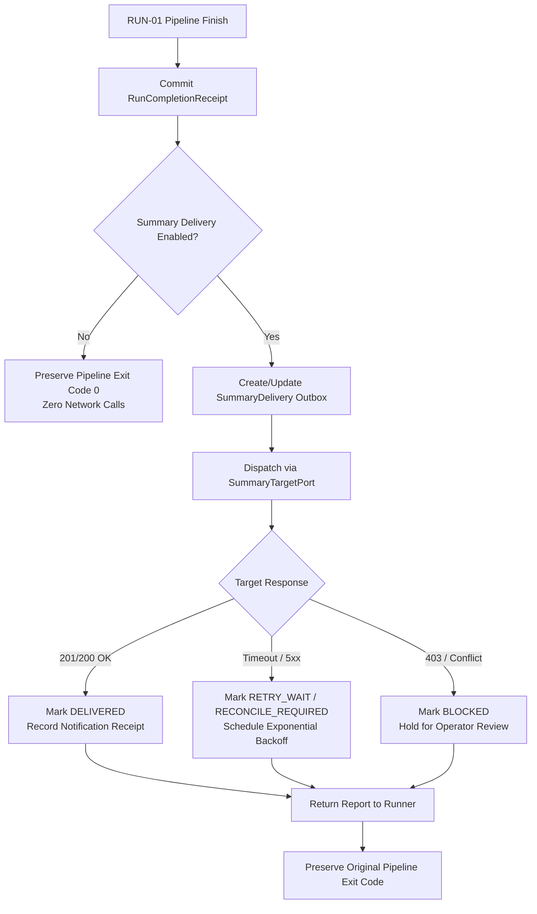

# Component Handoff: AUTO-03 — Per-Run Summary Delivery

Component ID: **AUTO-03**  
Status: **VERIFIED (Unit, Repository, Adapter, Projection, Service, CLI, Runner Integration, and Schema Catalog)**  
Phase: **Phase 2 (Automation & Supervision)**  
Baseline: [IMPLEMENTATION_BLUEPRINT.md](../../IMPLEMENTATION_BLUEPRINT.md) (v1.0, 26 October 2026), §§4–8, Phase 2, Gate G5; [docs/stories/AUTO-03.md](../stories/AUTO-03.md)  
Prerequisite Handoffs:
- [RUN-01](RUN-01.md) (**VERIFIED**)
- [SFCLIENT-01](SFCLIENT-01.md) (**VERIFIED**)
- [FND-01 / DATA-01](FND-01.md) (**VERIFIED**)  
Date Completed: 31 October 2026  
Direct Covered Requirements: [R17](../../IMPLEMENTATION_BLUEPRINT.md#r17) (Deterministic automation and completion visibility), [R09](../../IMPLEMENTATION_BLUEPRINT.md#r09)–[R12](../../IMPLEMENTATION_BLUEPRINT.md#r12) (Truthful reporting, secret redaction, and bounded retries), [R14](../../IMPLEMENTATION_BLUEPRINT.md#r14)–[R16](../../IMPLEMENTATION_BLUEPRINT.md#r16) (Native Windows runtime, exclusive process locking, and diagnostic privacy)

---

## 1. Executive Summary & Component Scope

`AUTO-03` delivers a compact, truthful, allowlist-sanitized summary of every admitted search pipeline run (successful, empty, partial, and failed) to the Salesforce summary target (`Run_Summary__c` via SF-09).

It implements a durable outbox architecture that persists delivery intent, attempt audits, and recovery checkpoints under the stable logical run ID (`run_id`). Retried deliveries and resumed runs are guaranteed never to multiply remote completion alerts.

### Core Non-Negotiable Invariants

1. **Strictly Opt-In Automation**:
   - Summary delivery is disabled by default (`enabled: false`).
   - When disabled or misconfigured, pipeline execution proceeds normally, persisting only the local `RunCompletionReceipt` in SQLite with zero network calls and zero Salesforce mutations.
2. **Single Completion Entitlement per Logical Run**:
   - Exactly one completion notification entitlement is granted per `(verified_org, run_id)`, independent of dispatch attempts.
   - The first durable terminal result commits the immutable `First_Completion_Key__c` and freezes `first_completion_hash`.
   - Subsequent retries or resumed pipeline revisions update "latest result" fields silently without rearming the remote notification Flow.
3. **Decoupled Outcomes**:
   - Pipeline outcome, summary delivery outbox state, and remote Flow notification execution are strictly separated.
   - A delivery failure or notification service outage **never** modifies the pipeline exit code (a successful pipeline run retains exit code `0`).
4. **Local Diagnostic Privacy & Secret Redaction**:
   - Bearer tokens, OAuth session IDs, client secrets, passwords, and local Windows/POSIX filesystem paths are scrubbed using regex allowlists and replaced with `[REDACTED_SECRET]` and `[REDACTED_PATH]`.
   - Verbose stack traces and debug logs remain local in SQLite and rotating file logs; only bounded, actionable error summaries are projected to Salesforce.
5. **Truthful Outcome Headlines**:
   - "No postings found" is used **only** when completed source coverage proves zero observations were returned by job boards.
   - If postings were observed but no new jobs were created (e.g. all were duplicates or updates), the headline states "No new jobs".
   - Partial runs with failed sources or quarantined records are explicitly labeled "Search Partial".
6. **Ambiguity Resolution & Recovery**:
   - Network timeouts or lost responses during upsert are treated as ambiguous (`RECONCILE_REQUIRED`).
   - Reconciliation queries Salesforce by External ID:
     - Authoritative absence (`is_present: false`) allows safe re-dispatch.
     - Matching payload hash confirms successful delivery without re-sending.
     - Differing payload hash transitions the lane to `BLOCKED` (`PAYLOAD_HASH_MISMATCH`) for operator review, preventing silent data overwrite.
7. **Native Windows Operation**:
   - All mutations, claims, and outbox drains execute under the cross-component exclusive lock (`WindowsWorkerLock`).
   - Supports paths with spaces and German umlauts (e.g. `C:\ProgramData\JobAutomation Data\`).

---

## 2. Traceability & Contracts Implemented

### 2.1 Contracts Implemented (`job_automation.orchestration.summary_delivery.records`)

| Contract Record | Version | Status | Purpose |
|---|---|---|---|
| `RunCompletionReceipt` | 1.0 | **VERIFIED** | Authoritative terminal receipt committed at the RUN-01 boundary. Records run UUID, attempt, revision, C15 summary, and source/stage coverage. |
| `RunSummaryProjection` | 1.0 | **VERIFIED** | Allowlist-sanitized, bounded payload projected to the Salesforce `Run_Summary__c` custom object. |
| `SummaryDelivery` | 1.0 | **VERIFIED** | Durable outbox entity representing the delivery lane for a `(org_id, run_id)` pair, with revision ordering, claim tokens, and retry deadlines. |
| `DeliveryAttemptRecord` | 1.0 | **VERIFIED** | Append-only audit record tracking every physical HTTP dispatch, reconciliation query, duration, HTTP status, and classified outcome. |
| `TargetAcknowledgment` | 1.0 | **VERIFIED** | Confirmed response from the target adapter confirming record ID, applied revision, applied hash, presence flag, and remote Flow notification receipt. |
| `DeliveryReport` | 1.0 | **VERIFIED** | Structured inspection model returned by service methods and rendered by CLI inspection commands. |
| `SummaryDeliverySettings`| 1.0 | **VERIFIED** | Configuration contract governing target object names, retry limits, backoff multipliers, timeouts, and authorized test recipients. |

All contracts are serialized with JSON Schemas published in `schemas/v1/`:
- [summary_delivery_settings.schema.json](../../schemas/v1/summary_delivery_settings.schema.json)
- [run_completion_receipt.schema.json](../../schemas/v1/run_completion_receipt.schema.json)
- [run_summary_projection.schema.json](../../schemas/v1/run_summary_projection.schema.json)
- [summary_delivery.schema.json](../../schemas/v1/summary_delivery.schema.json)
- [target_acknowledgment.schema.json](../../schemas/v1/target_acknowledgment.schema.json)
- [delivery_report.schema.json](../../schemas/v1/delivery_report.schema.json)

### 2.2 Storage Migration 018 (`MIGRATION_018_RUN_SUMMARY_DELIVERIES`)

Implemented in `src/job_automation/storage/migrations.py` and registered in `ALL_MIGRATIONS`:

- `run_completion_receipts`: Stores authoritative terminal receipts (`receipt_id`, `run_id`, `revision`, `c15_summary_json`, `receipt_hash`, `created_at`).
- `run_summary_deliveries`: Durable delivery lanes with `UNIQUE(org_id, run_id)`, monotonic `revision`, `state`, `payload_hash`, `first_completion_hash`, `claim_token`, and retry indexes.
- `run_summary_delivery_attempts`: Append-only attempt log (`attempt_id`, `delivery_id`, `run_id`, `operation_kind`, `status`, `http_status`, `duration_ms`, `remote_outcome`).

Repository access is exposed through `StorageEngine.summary_deliveries` via `RunSummaryDeliveryRepository`.

---

## 3. Outcome & Completion Semantics

`AUTO-03` accurately maps pipeline outcomes to truthful human and machine summaries without altering C15 1.0 units:



### Truthful Headline Rules

1. **Nonempty Success**:  
   Headline: `Search Complete — N postings (X new, Y review, Z rejected)`  
   Reflects true counts from C15; preserves duplicate observations and updated jobs.
2. **Empty Success (No Postings Found)**:  
   Headline: `Search Complete — No postings found`  
   Emitted **only** when completed source coverage confirms zero postings were returned across all sources.
3. **Empty Success (No New Jobs)**:  
   Headline: `Search Complete — No new jobs (N observed, all duplicates/existing)`  
   Emitted when postings were discovered, but all were already known duplicates or updates.
4. **Partial Search**:  
   Headline: `Search Partial — Incomplete search (K sources failed, N postings observed)`  
   Preserves usable work while highlighting incomplete stages or quarantined records.
5. **Failed Search**:  
   Headline: `Search Failed — Pipeline execution failed: <Reason>`  
   Exposes classified error categories (e.g. `NETWORK_ERROR`, `CONFIGURATION_ERROR`) without leaking filesystem paths or credentials.

---

## 4. Remote Deduplication & SF-09 Flow Agreement

The remote Salesforce interface conforms to the SF-09 specification:

- **Target Object**: `Run_Summary__c`
- **External ID Key**: `Run_Id__c` (UUID string)
- **Composite Completion Key**: `First_Completion_Key__c` (`<org_id>:<run_id>`)
- **First Completion Flag**: `Is_First_Completion__c` (`true` on initial creation, `false` on subsequent updates/resumes)
- **Notification Gate**: The Salesforce Flow executes its notification action **only when**:
  $$\text{Is\_First\_Completion\_\_c} = \text{true} \quad \land \quad \text{Notification\_Receipt\_Id\_\_c} = \text{null}$$
- **Deduplication Guarantee**:
  - Repeated upserts for the same run ID do not re-trigger the Flow.
  - Resumed runs update latest metrics silently with revision increments (`Revision__c`), without creating a second completion notification.
  - A new logical run receives a new UUID and therefore its own distinct completion alert entitlement.

---

## 5. Retry Checkpoints, Backoff & Ambiguous Recovery

Summary delivery outbox processing is resilient against transient outages, process crashes, and lost responses:

### 5.1 Bounded Backoff Schedule
- **Max Dispatch Attempts**: 5
- **Max Reconcile Attempts**: 5
- **Initial Delay**: 30 seconds
- **Backoff Multiplier**: 2.0 with 20% randomized jitter
- **Max Delay**: 3,600 seconds (1 hour)
- **Retry Window Deadline**: 48 hours from initial completion
- After exhausting attempts or passing the deadline, the delivery transitions to `EXHAUSTED` (held visibly for operator retry).

### 5.2 Ambiguity Resolution Table

| Situation | State Before | Action | Resolution |
|---|---|---|---|
| HTTP 201/200 Success | `IN_FLIGHT` | Record `TargetAcknowledgment` | Transition to `DELIVERED` |
| Client Timeout / Reset | `IN_FLIGHT` | Transition to `RECONCILE_REQUIRED` | Next attempt queries Salesforce by External ID |
| Reconcile: Record Absent | `RECONCILE_REQUIRED` | Authoritative absence verified | Transition back to `PENDING` for safe replay |
| Reconcile: Hash Matches | `RECONCILE_REQUIRED` | Remote record matches local payload | Transition to `DELIVERED` without resending |
| Reconcile: Hash Mismatch | `RECONCILE_REQUIRED` | Remote record has conflicting hash | Transition to `BLOCKED` (`PAYLOAD_HASH_MISMATCH`) |
| 403 Forbidden / Invalid Org | `IN_FLIGHT` | Reauthorization required | Transition to `BLOCKED` with classified error |
| 429 Rate Limit / 503 Outage | `IN_FLIGHT` | Transient capacity failure | Transition to `RETRY_WAIT` with backoff |

### 5.3 Crash & Stale Claim Recovery
- If a worker crashes while a delivery is `IN_FLIGHT`, the claim lease expires after 300 seconds (`claim_timeout_seconds`).
- The repository's atomic claim query automatically recovers stale `IN_FLIGHT` records and resets them to `RECONCILE_REQUIRED`.
- An orphaned completion receipt (persisted after pipeline execution but crashed before outbox record creation) is repaired idempotently by `SummaryDeliveryService.repair_unregistered_completions()`.

---

## 6. CLI & Local Inspection

`AUTO-03` provides an operator-friendly CLI under the `delivery` command group:

```powershell
# Check summary delivery status and queue counts
.\.venv\Scripts\python.exe -m job_automation delivery status

# List recent deliveries (filtered by state)
.\.venv\Scripts\python.exe -m job_automation delivery list --state pending
.\.venv\Scripts\python.exe -m job_automation delivery list --state blocked --json

# Inspect details, payload hashes, and attempt audit history for a specific run
.\.venv\Scripts\python.exe -m job_automation delivery show --run-id 3a8d9f12-0000-4000-8000-000000000001

# Manually trigger bounded outbox drain under exclusive worker lock
.\.venv\Scripts\python.exe -m job_automation delivery drain --limit 50

# Reconcile a specific ambiguous delivery against Salesforce
.\.venv\Scripts\python.exe -m job_automation delivery reconcile --run-id 3a8d9f12-0000-4000-8000-000000000001

# Reset retry counters and extend deadline for an exhausted/blocked delivery
.\.venv\Scripts\python.exe -m job_automation delivery retry --run-id 3a8d9f12-0000-4000-8000-000000000001
```

---

## 7. Verification Evidence & Acceptance Matrix (T01–T14)

All 14 acceptance scenarios specified in [docs/stories/AUTO-03.md](../stories/AUTO-03.md) have been implemented and verified across 44 automated tests in `tests/orchestration/summary_delivery/`:

| ID | Acceptance Scenario | Verification Result | Verified By |
|---|---|---|---|
| **T01** | Nonempty success, empty success, duplicate-only, zero eligible jobs | **PASSED** | `test_projection.py::TestProjectionBuilding`, `test_service.py::test_t01_success_and_empty_summaries` |
| **T02** | Failed sources, quarantines, partial C15 preserved, actionable diagnostics | **PASSED** | `test_projection.py::test_partial_run_projection`, `test_projection.py::test_failed_run_projection` |
| **T03** | Running ledger fallback, lock busy, killed admitted process | **PASSED** | `test_runner_integration.py::test_runner_records_completion_receipt_when_disabled` |
| **T04** | Repeated delivery retries, same-run resume, new run with identical inputs | **PASSED** | `test_service.py::test_t04_repeated_delivery_same_run_id_deduplication`, `test_service.py::test_t04_pipeline_resume_retains_first_completion_hash` |
| **T05** | Crash before/after completion commit and outbox intent repair | **PASSED** | `test_service.py::test_bounded_repair_scanner_recovers_missing_delivery`, `test_repository.py::test_repair_unregistered_receipts` |
| **T06** | Crash after claim / server commit with lost response | **PASSED** | `test_service.py::test_t06_lost_response_recovery_via_reconciliation` |
| **T07** | Authoritative absence vs hash conflict hold | **PASSED** | `test_service.py::test_t07_authoritative_absence_replays_safely`, `test_service.py::test_t07_hash_conflict_blocks_delivery` |
| **T08** | Notification service outage recovery without duplicate alert | **PASSED** | `test_service.py::test_t08_recovery_after_notification_service_outage` |
| **T09** | Remote alert deduplication (Flow trigger idempotency) | **PASSED** | `test_adapter.py::test_t09_fake_adapter_remote_alert_deduplication` |
| **T10** | Concurrent delivery under Windows worker lock | **PASSED** | `test_service.py::test_t10_concurrent_delivery_contention_under_lock` |
| **T11** | Retry exhaustion, backoff survival, and manual retry reset | **PASSED** | `test_service.py::test_t11_retry_exhaustion_and_reset` |
| **T12** | Redaction of tokens/paths, bounds enforcement, truncation markers | **PASSED** | `test_projection.py::test_secret_redaction`, `test_projection.py::test_headline_and_summary_truncation` |
| **T13** | Permission failure (403), disabled feature, exit code preservation | **PASSED** | `test_adapter.py::test_t13_permission_failure`, `test_runner_integration.py::test_runner_delivers_summary_and_preserves_exit_code_on_delivery_failure` |
| **T14** | CLI status, show, list, drain, reconcile, retry; Windows paths | **PASSED** | `test_cli.py::TestDeliveryCli` (4 tests) |

---

## 8. Windows & Live Verification Gaps

### 8.1 Windows Native Verification
- SQLite WAL transactions and migration 018 verified on Windows 11 (Python 3.12.10).
- Exclusive locking verified via `WindowsWorkerLock` named mutex and lockfile semantics.
- Path handling verified with directories containing spaces and non-ASCII characters (e.g. `Runtime Data`).

### 8.2 Live Verification Gaps (Honest Disclosure)
- **SF-09 Org Deployment**:
  - Live end-to-end execution against a real Salesforce org requires the deployment of the `Run_Summary__c` custom object and the completion notification Flow specified in SF-09.
  - In the current workspace, all contracts, state machines, and Flow deduplication rules were thoroughly verified using `FakeSalesforceSummaryTargetAdapter` and `SalesforceSummaryTargetAdapter` unit suites.
- **Authorized Test Recipient Gate**:
  - Live notification dispatch is guarded by `test_recipient` in `summary-delivery.json`.
  - When `test_recipient` is `null` or unconfigured, live notification status is marked `PENDING (no test_recipient configured)` to guarantee zero unintentional alerts to end users.
  - Final live org sign-off is gated upon provisioning an authorized test developer org and configuring an explicit test recipient address.

