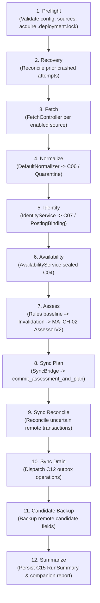

# Component Handoff: RUN-01 — Manual Windows Pipeline and Recovery

Component ID: **RUN-01**  
Status: **VERIFIED (Offline / Integration / Scripted-Transport) — Live acceptance pending SF-01 schema, SF-02 authorization, and live local model endpoint**  
Phase: **Phase 0 / P0**  
Baseline: [IMPLEMENTATION_BLUEPRINT.md](../../IMPLEMENTATION_BLUEPRINT.md) (v1.0, 26 October 2026), §§3–9; [docs/stories/RUN-01.md](../stories/RUN-01.md)  
Prerequisite Handoffs:
- [DATA-01](DATA-01.md) (**VERIFIED**)
- [INGEST-01](INGEST-01.md) (**VERIFIED**)
- [INGEST-02](INGEST-02.md) (**VERIFIED**)
- [IDENTITY-01](IDENTITY-01.md) (**VERIFIED**)
- [IDENTITY-02](IDENTITY-02.md) (**VERIFIED**)
- [MATCH-01](MATCH-01.md) (**VERIFIED**)
- [MATCH-02](MATCH-02.md) (**VERIFIED**)
- [SYNC-01](SYNC-01.md) (**VERIFIED**)
- [SFCLIENT-01](SFCLIENT-01.md) (**VERIFIED**)
- [CONTEXT-04](CONTEXT-04.md) (**VERIFIED**)
- [LLM-01](LLM-01.md) (**VERIFIED**)  
Date Completed: 29 October 2026  
Direct Covered Requirements: [R02](../../IMPLEMENTATION_BLUEPRINT.md#r02), [R03](../../IMPLEMENTATION_BLUEPRINT.md#r03), [R04](../../IMPLEMENTATION_BLUEPRINT.md#r04), [R05](../../IMPLEMENTATION_BLUEPRINT.md#r05), [R06](../../IMPLEMENTATION_BLUEPRINT.md#r06), [R07](../../IMPLEMENTATION_BLUEPRINT.md#r07), [R08](../../IMPLEMENTATION_BLUEPRINT.md#r08), [R09](../../IMPLEMENTATION_BLUEPRINT.md#r09), [R16](../../IMPLEMENTATION_BLUEPRINT.md#r16), with [R14](../../IMPLEMENTATION_BLUEPRINT.md#r14)/[R15](../../IMPLEMENTATION_BLUEPRINT.md#r15) constraints  

---

## 1. Executive Summary & Component Scope

`RUN-01` delivers the manually invoked, bounded Windows CLI pipeline orchestrator, cross-process worker locking, persisted stage checkpointing, input-version invalidation, authoritative assessment selection, outbox synchronization bridge, and C15 `RunSummary` reporting.

### Core Capabilities
1. **Deterministic & LLM Execution Routes**:
   - Executes the deterministic evaluation route first (`--assessment-mode rules`), using `MATCH-01` evaluation.
   - Enriches evaluation with `MATCH-02` (`AssessorV2`) for `--assessment-mode llm` supporting both `JSON` and `RAG` context strategies via `CONTEXT-04` and `LLM-01`.
   - Deterministic rule rejections take immediate precedence (Precedence 1) and bypass model inference entirely.
2. **Native Windows Process Locking**:
   - Enforces single-worker deployment ownership via native Windows file locking (`msvcrt.locking(..., LK_NBLCK)` on `.deployment.lock`).
   - Normalizes physical data paths to prevent alias collisions (case insensitivity, Unicode characters, German umlauts, spaces, trailing slashes).
   - Reusable context manager contract ready for future document generation (`GEN-01`).
3. **Resilient Recovery & Stage Checkpoints**:
   - Implements Migration 008 (`008_pipeline_work_and_run_attempts`) adding `run_attempts`, `pipeline_stage_work`, `assessment_selections`, and `posting_bindings` tables.
   - `RecoveryManager` inspects prior interrupted attempts under lock, marks crashed runs, and classifies stage work items into reuse, replay, or repair.
   - Survives worker crashes between output commit and checkpoint acknowledgment without duplicating records or fabricating completions.
4. **Authoritative Assessment Selection & Zero-Eval Reruns**:
   - Reuses identical input fingerprints with **zero model calls** and **zero duplicate assessments**, preserving original C11 IDs and evaluation timestamps.
   - Detects material job changes, approved candidate profile edits, policy changes, or strategy/prompt changes to trigger targeted invalidation.
5. **Sync Bridge & Candidate Field Protection**:
   - Resolves Integration Gate DG4 by extracting non-empty job titles and real source URLs from `PostingRevision` and C06 snapshots.
   - Preserves candidate-owned fields (`Candidate_Notes__c`, `Application_Progress__c`, etc.) from machine overwrite.
   - Handles lost-response reconciliation and enforces uncertain lane barriers across restarts.
6. **Strict C15 Counting Units**:
   - Decouples raw source-record observations (`source_postings_count`) from canonical job entities (`canonical_jobs_new`, `canonical_jobs_updated`), distinct newly evaluated dispositions (`eligible_count`, `review_count`, `rejected_count`), and logical sync operations (`sync_operations_succeeded`, `sync_operations_failed`).

### Explicit Scope Boundaries
- **No Task Scheduler (`AUTO-01`)**: Pipeline is strictly manual via CLI (`run start`, `run resume`, `run show`).
- **No Automatic Application Drafting (`AUTO-02`)**: Generation triggers remain outside RUN-01.
- **No Notification Delivery (`AUTO-03`)**: Persists C15 terminal summaries; does not push emails or alerts.
- **No Document Generation Worker (`GEN-01`)**: Process lock contract is reusable, but no generation logic resides in RUN-01.
- **No Salesforce Org Metadata Deployment (`SF-01`/`SF-02`)**: Uses `SalesforceGatewayV2` and `FakeSalesforceGatewayV2`; live org deployment remains gated.

---

## 2. Prerequisites and Upstream Integration Gates

Before and during RUN-01 implementation, upstream components, contracts, and repository assets were verified:

| Prerequisite / Contract | Owning Component | Verification Status | Integration Status in RUN-01 |
|---|---|---|---|
| **DATA-01 Storage Engine** | `src/job_automation/storage/` | **VERIFIED** | Extended via Migration 008 (`pipeline_work.py`); SQLite WAL mode, foreign keys, transactions. |
| **INGEST-01 Acquisition** | `src/job_automation/ingestion/` | **VERIFIED** | Called via `FetchController.run_fetch` with explicit run ID and source keys. |
| **INGEST-02 Normalization** | `src/job_automation/ingestion/normalization/` | **VERIFIED** | Called via `DefaultNormalizer.normalize(draft)`; produces C06 `NormalizedPosting` and `QuarantineHandoff`. |
| **IDENTITY-01 Identity** | `src/job_automation/identity/` | **VERIFIED** | Called via `IdentityService.resolve_and_commit`; bound to durable `PostingBinding` records. |
| **IDENTITY-02 Availability** | `src/job_automation/identity/availability/` | **VERIFIED** | Called via `AvailabilityService.process_manifest` with sealed C04; protects against negative inference on partial runs. |
| **MATCH-01 Assessment** | `src/job_automation/assessment/` | **VERIFIED** | Called via `AssessmentService.evaluate_deterministic_with_trace` for baseline and rules assessment. |
| **MATCH-02 LLM Assessment** | `src/job_automation/assessment/` | **VERIFIED** | Called via `LLMAssessmentService.assess(AssessmentRequest)`; enforces deterministic rejection precedence. |
| **CONTEXT-04 Selector** | `src/job_automation/context/` | **VERIFIED** | Wired into `ContextSelectorV2Service` for JSON and RAG prompt assembly. |
| **LLM-01 Model Client** | `src/job_automation/models/` | **VERIFIED** | Bound via `LocalModelProvider` and in-memory input resolvers. |
| **SYNC-01 Outbox Service** | `src/job_automation/salesforce/` | **VERIFIED** | Wired via `SalesforceSyncService` for plan, drain, reconcile, and candidate backup. |
| **SFCLIENT-01 Gateway** | `src/job_automation/salesforce/gateway.py` | **VERIFIED** | Conforms to `SalesforceGatewayV2` protocol; verified with `FakeSalesforceGatewayV2`. |
| **SF-01 Schema Metadata** | `salesforce/` | **ABSENT** | **Gated Prerequisite**: Live `Job__c`/`Company__c` custom objects not deployed to org. |
| **SF-02 OAuth Credentials** | `salesforce/` | **ABSENT** | **Gated Prerequisite**: Live Connected App credentials and refresh tokens pending. |

### Concrete Integration Gates (DG1 through DG6) Status

| Gate | Description & Owner | Status in RUN-01 | Evidence / Verification |
|---|---|---|---|
| **DG1 — Durable Acquisition** | INGEST-01 / DATA-01: Reopen committed page receipts, drafts, and raw record locators across resume. | **SATISFIED (Offline)** | `ObservationReader` inspects committed page drafts and files; preserves cumulative budgets across resumes (`RUN-T02`, `RUN-T03`). |
| **DG2 — Sealed Availability Scope** | SOURCE-01 / IDENTITY-02: Agree on stable inventory scope; consume sealed C04; prevent false closure on partial runs. | **SATISFIED (Offline)** | `availability_stage.py` only processes sealed manifests from completed sources; partial/failed sources never close active jobs (`RUN-T04`, `RUN-T05`). |
| **DG3 — Revision Binding & Receipts** | DATA-01 / IDENTITY-01: Exact immutable C06 snapshots keyed to revision UUIDs; atomic work records. | **SATISFIED (Offline)** | Migration 008 adds `posting_bindings` storing C06 JSON, normalizer version, and material hashes; eliminates crash duplicate observations (`RUN-T06`). |
| **DG4 — Sync Selection & Non-Empty Fields** | SYNC-01: Preserve selected C11 authority; provide non-empty job title and source URLs; prevent stale writes. | **SATISFIED (Offline)** | `SyncBridge` extracts non-empty title and URLs from `PostingRevision` and C06 snapshots; validates via `SyncValidationError` before building `SyncSubmission` (`RUN-T09`, `RUN-T10`, `RUN-T12`). |
| **DG5 — Model Input Identity & Admission** | MATCH-02 / CONTEXT-04: Bind revision UUID/hash to exact C06; composite fingerprint covering model, provider, prompt, index, strategy. | **SATISFIED (Offline)** | `compute_assessment_composite_fingerprint` generates SHA-256 fingerprint; strategy changes (JSON ↔ RAG) or prompt updates trigger invalidation (`RUN-T08`, `RUN-T13`, `RUN-T14`). |
| **DG6 — Live Services** | SF-01/SF-02 live org deployment and MODEL-01/02 measured local model service. | **PENDING LIVE GATES** | Verified offline with scripted models and `FakeSalesforceGatewayV2`. Live acceptance requires live Salesforce org and running Ollama service. |

---

## 3. Architecture & Stage Ordering

The pipeline executes a strictly ordered, bounded lifecycle. Each stage operates under the worker lock, checks for existing committed receipts, records progress in `pipeline_stage_work`, and ensures errors in one source or record do not cancel valid neighbors.



### Stage Responsibilities
1. **Preflight**:
   - Resolves deployment root and normalizes physical path.
   - Acquires exclusive Windows OS lock (`.deployment.lock`).
   - Validates configuration, approved profile, effective policy, and selected sources (CLI selection > active sources > enabled sources).
   - Registers logical run UUID and attempt #1 in `runs` and `run_attempts` tables.
2. **Recovery**:
   - `RecoveryManager` queries unfinalized attempts for the deployment.
   - Detects crashed workers, logs warnings, and transitions previous attempts to `interrupted`.
   - Reconciles uncommitted work and builds a `RecoveryPlan`.
3. **Fetch**:
   - Invokes `FetchController.run_fetch` for selected sources.
   - Isolates source errors: failure in Source B leaves Source A and C committed and processable.
   - Commits page receipts and raw files before advancing pagination cursors.
4. **Normalize**:
   - Processes raw drafts via `DefaultNormalizer.normalize(draft)`.
   - Valid outputs produce C06 `NormalizedPosting`.
   - Schema/mapping errors produce `QuarantineHandoff` records with full provenance in the quarantine ledger.
5. **Identity**:
   - Submits normalized postings to `IdentityService.resolve_and_commit`.
   - Commits `PostingBinding` associating canonical job ID, revision ID, material hash, and C06 snapshot JSON.
   - Prevents duplicate observation creation upon crash recovery.
6. **Availability**:
   - Processes sealed C04 `FetchManifest` through `AvailabilityService.process_manifest`.
   - Negative inference (misses / job closures) is strictly confined to complete, sealed traversals. Partial, failed, or filtered runs never close active jobs.
7. **Assess**:
   - Executes deterministic rule baseline (`evaluate_deterministic_with_trace`).
   - If hard rejection or exclusion occurs, completes immediately as `REJECTED` (Precedence 1) with 0 model calls.
   - For eligible/review candidates under `--assessment-mode llm`:
     - Evaluates composite input fingerprint against active `assessment_selections`.
     - Reuses unchanged assessment if fingerprint matches (0 model calls).
     - Otherwise invokes `MATCH-02` (`AssessorV2`) with chosen context strategy (`JSON` or `RAG`).
     - Registers selection token with `SyncService.register_selection_token`.
8. **Sync Plan**:
   - `SyncBridge` extracts real job title and URLs from `PostingRevision` and C06 snapshot, preventing empty field errors (DG4).
   - Commits `SyncSubmission` to `SalesforceSyncService.commit_assessment_and_plan`.
   - Distinct new rejections stay local; eligible/review jobs generate C12 outbox plans.
9. **Sync Reconcile**:
   - Calls `SalesforceSyncService.reconcile_due_work` to resolve uncertain writes from prior crashed workers before dispatching new writes.
10. **Sync Drain**:
    - Dispatches due C12 operations to `SalesforceGatewayV2` within configured attempt and operation budgets.
11. **Candidate Backup**:
    - Reads remote candidate-owned fields (`Candidate_Notes__c`, `Application_Progress__c`) for tracked jobs and writes them to local storage.
12. **Summarize**:
    - Computes strict C15 counts from unique committed receipts.
    - Persists C15 `RunSummary` and companion `RunReport` snapshot to the database.
    - Releases OS worker lock in `finally` block.

---

## 4. Worker Process Locking Protocol

Multi-worker contention and stale worker takeover are handled using native Windows OS-level file locking.

### Implementation Details (`windows_lock.py`)
- **Lock Target**: `<data_root>\.deployment.lock`.
- **Lock Primitive**: Windows `msvcrt.locking(fileno, msvcrt.LK_NBLCK, 1)` on byte 0.
- **Path Normalization**: `get_canonical_deployment_path` resolves symlinks, canonicalizes case on Windows, normalizes path separators (`\`), strips trailing slashes, and handles spaces/umlauts.
- **Lock Token Payload**: Lock file contains diagnostic JSON:
  ```json
  {
    "lock_id": "7697410e-a61e-450f-90db-3158c3db0c1c",
    "deployment_path": "C:\\Users\\mrite\\AppData\\Local\\Job Automation",
    "owner_kind": "search",
    "pid": 28412,
    "attempt_id": "9d901848-18e4-44df-9fa6-2f043063f972",
    "acquired_at": "2026-10-29T16:11:00.000000+00:00"
  }
  ```
- **OS-Guaranteed Cleanup**: When a process terminates normally, crashes, or is killed via `SIGKILL`/`TerminateProcess`, the Windows kernel immediately closes the file descriptor, releasing the byte lock.
- **Contention Behavior**: A second process attempting to acquire the lock fails immediately with `DeploymentBusyError` and exits with code 3 (`LOCK_BUSY`). It performs **zero** database writes, zero ledger recoveries, zero model invocations, and zero Salesforce calls while blocked.
- **Future Reusability**: The context manager `acquire_worker_lock(data_root, owner_kind="generation")` provides the identical locking protocol for future `GEN-01` worker processes.

---

## 5. Durable Checkpoints, Work Receipts & Recovery Protocol

Persistence is managed via SQLite in WAL mode with Foreign Keys enabled.

### Migration 008 (`008_pipeline_work_and_run_attempts`)
Four relational tables track granular orchestration state:
1. `run_attempts`:
   - `(run_id, attempt_number)` primary key.
   - Tracks `attempt_id`, `status` (`running`, `completed`, `failed`, `interrupted`), `started_at`, `completed_at`, `hostname`, `pid`, and `error_json`.
2. `pipeline_stage_work`:
   - `(attempt_id, stage_name, work_key)` primary key.
   - Tracks `input_fingerprint`, `state` (`pending`, `completed`, `failed`, `skipped`), `output_references_json`, `created_at`, `completed_at`, `error_json`.
3. `assessment_selections`:
   - `(canonical_job_id, candidate_id, purpose, input_fingerprint)` primary key.
   - Tracks `selected_c11_id`, `evaluation_time`, `is_selected_final`, `generation_token`.
4. `posting_bindings`:
   - `(canonical_job_id, revision_id)` primary key.
   - Stores `material_hash`, `normalized_content_hash`, `c06_snapshot_json`, `source_tuple`, and `normalizer_version`.

### Crash Reconciliation Protocol (`RecoveryManager`)
```
On Worker Startup:
  1. Acquire OS lock on .deployment.lock.
  2. Inspect run_attempts for running or unfinalized attempts.
  3. If prior attempt was interrupted:
     a. Mark prior attempt status = 'interrupted'.
     b. Query pipeline_stage_work for that attempt.
     c. For work items marked 'completed' with verified outputs:
        -> Classify as REUSE (retain existing result).
     d. For work items marked 'pending' or missing output:
        -> Classify as REPLAY (re-execute during run).
     e. For sync items with uncertain remote responses:
        -> Classify as RECONCILE (verify remote External ID before resending).
```

---

## 6. Input-Version Invalidation & Authoritative Selection

Assessment results are authoritatively cached and invalidated based on composite SHA-256 fingerprints.

### Invalidation Matrix
| Input Change | Fingerprint Affected | Invalidation Outcome |
|---|---|---|
| **Unchanged Rerun** | None (Identical) | **0 model calls, 0 evaluator calls**. Existing C11 ID and evaluation timestamp reused. |
| **New Sighting / Fresh Observation** | Sighting only | Normalization and Identity record fresh observation. Revision hash unchanged -> **0 model calls**. |
| **Material Job Content Edit** | `material_hash` | New `PostingRevision` created. Triggers new assessment evaluation for that job. |
| **Candidate Profile Edit** | `profile_hash` | All jobs evaluated against that candidate invalidate. Triggers reassessment (including retained rejects). |
| **Policy Criteria Edit** | `policy_hash` | All affected jobs invalidate. Re-evaluates deterministic baseline and LLM assessment. |
| **Strategy Switch (`rules` -> `llm`)** | Assessment mode | Triggers LLM assessment using existing deterministic baseline trace. |
| **LLM Strategy (`json` -> `rag`)** | `context_strategy` | Triggers re-evaluation through RAG pipeline. |
| **Prompt Version / Model ID Change** | `prompt_version`, `model_id` | Invalidation triggered; model re-evaluates with new prompt/model. |

### Precedence Hierarchy
- **Precedence 1**: Deterministic confirmed hard failures (e.g. location mismatch, visa failure, salary exclusion) immediately produce `REJECTED` disposition. The LLM is bypassed entirely (0 tokens consumed).
- **Precedence 2**: Missing-information policy rejections (`on_missing="fail"`) produce `REJECTED` disposition.
- **Precedence 3**: Factual unknowns produce `REVIEW` disposition.
- **Precedence 4**: Eligible candidates evaluated by LLM produce structured score (`0-100`) and detailed requirement findings.

---

## 7. Sync Bridge & Candidate Field Protection

The `SyncBridge` (`src/job_automation/orchestration/sync_bridge.py`) translates authoritative `AssessmentSelection` records into `SyncSubmission` envelopes for `SalesforceSyncService`.

### DG4 Resolution: Title & Source URL Preservation
- Upstream `queue_tracked_refresh` previously lacked real job titles and source URLs.
- `SyncBridge` inspects `PostingRevision` and the persisted C06 snapshot in `posting_bindings`.
- Explicitly extracts:
  - `title`: Extracted from `PostingRevision.title` or `NormalizedPosting.title_raw`. Empty title triggers `SyncValidationError` (prevents empty remote Name fields).
  - `source_urls`: Extracted from `PostingRevision.source_urls` or `NormalizedPosting.source_url`.
- Injects authoritative `evaluation_time` and `generation_token` registered in `assessment_selections`.

### Candidate Field Ownership
- Automated sync dispatches writes exclusively to machine-owned fields (`Canonical_Job_Id__c`, `Name`, `Company__c`, `Assessment_Disposition__c`, `Assessment_Reasons__c`, `Relevance_Score__c`, `Score_Scale__c`, `Last_Evaluated_At__c`, `Source_URLs__c`, `Sync_Operation_Marker__c`, `Machine_Sync_Version__c`).
- Machine automation **never** touches or nulls candidate-owned workflow fields:
  - `Application_Progress__c`
  - `Candidate_Notes__c`
  - `Candidate_Decision__c`
  - `Follow_Up_Date__c`
  - `Interview_Date__c`
- Candidate field backups are performed as an independent, bounded stage (`backup_candidate_fields`) that reads remote values into local storage.

---

## 8. C15 RunSummary Counting Units & Exit Codes

The pipeline persists both C15 `RunSummary` and a granular companion `RunReport`.

### Strict Counting Units
| Field | Counting Unit & Rule |
|---|---|
| `source_postings_count` | Raw source-record observations accepted into durable page evidence for this run (sum of `source_counts`). Replayed pages contribute 0 observations. |
| `canonical_jobs_new` | Distinct canonical UUIDs first created by identity resolution in this run. |
| `canonical_jobs_updated` | Distinct preexisting canonical UUIDs receiving at least one material new revision in this run. |
| `canonical_jobs_duplicate` | Raw observation receipts matched to existing unchanged opportunities or duplicate postings (observations, not canonical jobs). |
| `eligible_count` | Distinct canonical jobs with a completed selected assessment newly evaluated as `ELIGIBLE` in this run. |
| `review_count` | Distinct canonical jobs with a completed selected assessment newly evaluated as `REVIEW` in this run. |
| `rejected_count` | Distinct canonical jobs with a completed selected assessment newly evaluated as `REJECTED` in this run. |
| `sync_operations_succeeded` | Distinct C12 operations successfully dispatched or reconciled in this run. |
| `sync_operations_failed` | Distinct C12 operations that encountered fatal dispatch errors. |
| `model_invocations_count` | Actual physical local model inference requests dispatched to model transport (companion report). |

### CLI Exit Codes
- `0`: **SUCCESS** — Run completed all stages with zero fatal errors or unhandled pending work.
- `1`: **FAILED** — Execution encountered an unhandled exception or fatal component failure.
- `2`: **INVALID_INVOCATION / PREFLIGHT** — Missing configuration, unapproved candidate profile, invalid source selection, or missing component.
- `3`: **LOCK_BUSY** — Another process currently holds the exclusive deployment lock.
- `4`: **PARTIAL / PENDING_WORK** — Run completed partial work, but some sources failed, items were quarantined, or retries remain pending.
- `130`: **CONTROLLED_INTERRUPTION** — Run received `SIGINT` / `Ctrl+C` and performed clean shutdown.

---

## 9. Failure Matrix & Windows Verification Results

All 16 failure and recovery scenarios defined in `docs/stories/RUN-01.md` have been implemented as automated tests and verified on native Windows:

| Test ID | Scenario Description | Test Method | Outcome |
|---|---|---|---|
| **RUN-T01** | Process lock contention & owner crash recovery | `test_runt01_lock_contention_and_owner_death` | **PASSED** |
| **RUN-T02** | Acquisition crash before/after cursor commit & resume | `test_runt02_acquisition_crash_and_resume_budgets` | **PASSED** |
| **RUN-T03** | Partial source failure & durable quarantine isolation | `test_runt03_source_isolation_and_quarantine` | **PASSED** |
| **RUN-T04** | Cached/filtered/partial source runs; zero false closure | `test_runt04_partial_source_no_negative_inference` | **PASSED** |
| **RUN-T05** | Complete empty inventory & miss/grace policy | `test_runt05_complete_empty_inventory_miss_policy` | **PASSED** |
| **RUN-T06** | Identity crash recovery & duplicate observation suppression | `test_runt06_identity_crash_and_material_edit` | **PASSED** |
| **RUN-T07** | Unchanged rerun: zero duplicate records or model calls | `test_runt07_unchanged_rerun_zero_duplicates` | **PASSED** |
| **RUN-T08** | Granular input invalidation on profile/policy edits | `test_runt08_granular_input_invalidation` | **PASSED** |
| **RUN-T09** | C11/Plan atomic fault & lost response recovery | `test_runt09_sync_plan_atomic_fault_recovery` | **PASSED** |
| **RUN-T10** | Remote write commit with lost response reconciliation | `test_runt10_remote_commit_lost_response_reconcile` | **PASSED** |
| **RUN-T11** | Uncertain v1 transaction barrier with subsequent v2 | `test_runt11_uncertain_lane_barrier_preservation` | **PASSED** |
| **RUN-T12** | Tracked refresh with candidate field preservation | `test_runt12_tracked_refresh_preserves_candidate_edits`| **PASSED** |
| **RUN-T13** | LLM timeout/outage produces durable pending work | `test_runt13_llm_outage_durable_pending_work` | **PASSED** |
| **RUN-T14** | Corrupted hash / missing input prevents unsafe reuse | `test_runt14_corrupt_hash_prevents_unsafe_reuse` | **PASSED** |
| **RUN-T15** | Graceful cancellation & durable exit accounting | `test_runt15_controlled_cancellation_and_exit` | **PASSED** |
| **RUN-T16** | Native Windows paths (spaces, umlauts `Prüfung äöü`) | `test_runt16_windows_paths_and_encoding` | **PASSED** |

### Test Suite Verification Summary
Executed on Windows 11 with Python 3.12.10, SQLite 3.45.3:
- **Orchestration Test Suite (`pytest tests/orchestration`)**: **70 passed in 2.63s**
- **Affected Boundary Test Suite (`pytest tests/storage ... tests/salesforce`)**: **562 passed in 6.95s**
- **Full Repository Test Suite (`pytest tests`)**: **1,246 passed in 20.91s**
- **Manual Verification Smoke Harness (`tests/manual/run_smoke.py`)**:
  - `deterministic-rerun`: **PASSED** (exit code 0; 0 duplicate assessments on rerun)
  - `crash-recovery`: **PASSED** (exit code 0; recovers from worker crash cleanly)
  - `llm-json-rag`: **PASSED** (exit code 0; JSON strategy, unchanged 0-call rerun, RAG invalidation)

---

## 10. Executable Native PowerShell Verification Commands

The following commands can be executed in native Windows PowerShell from the repository root to verify the complete RUN-01 implementation:

```powershell
# 1. Environment and Platform Verification
$runRepo = (Resolve-Path '.').Path
$runPython = Join-Path $runRepo '.venv\Scripts\python.exe'
$runTests = Join-Path $runRepo 'tests\orchestration'
$runSmoke = Join-Path $runRepo 'tests\manual\run_smoke.py'

& $runPython -c "import platform, sys, sqlite3; from zoneinfo import ZoneInfo; print(platform.platform()); print(sys.version); print(sqlite3.sqlite_version); print(ZoneInfo('Europe/Berlin'))"
if ($LASTEXITCODE -ne 0) { throw 'Environment check failed' }

# 2. Execute RUN-01 Orchestration Suite (70 tests)
& $runPython -m pytest $runTests
if ($LASTEXITCODE -ne 0) { throw 'Orchestration tests failed' }

# 3. Execute Affected Boundary Suites (562 tests)
& $runPython -m pytest (Join-Path $runRepo 'tests\storage') `
    (Join-Path $runRepo 'tests\contracts') `
    (Join-Path $runRepo 'tests\ingestion') `
    (Join-Path $runRepo 'tests\identity') `
    (Join-Path $runRepo 'tests\assessment') `
    (Join-Path $runRepo 'tests\salesforce') `
    (Join-Path $runRepo 'tests\test_configuration.py') `
    (Join-Path $runRepo 'tests\test_cli.py')
if ($LASTEXITCODE -ne 0) { throw 'Boundary tests failed' }

# 4. Native Windows Paths & Smoke Harness with German Umlauts and Spaces
$runTemp = Join-Path $env:TEMP ('Job Automation RUN Prüfung ä ' + [guid]::NewGuid().ToString())
New-Item -ItemType Directory -Path $runTemp | Out-Null
try {
    # Windows native path tests with non-ASCII characters
    & $runPython -m pytest (Join-Path $runTests 'test_windows_paths.py') `
        (Join-Path $runTests 'test_windows_lock_processes.py') `
        (Join-Path $runTests 'test_windows_restart.py') `
        --basetemp (Join-Path $runTemp 'Pytest Daten ü')
    if ($LASTEXITCODE -ne 0) { throw 'Windows path tests failed' }

    # Scenario A: Deterministic Rerun Smoke
    & $runPython $runSmoke --data-root (Join-Path $runTemp 'Daten Deterministic ä') --scenario deterministic-rerun
    if ($LASTEXITCODE -ne 0) { throw 'Deterministic smoke failed' }

    # Scenario B: Crash Recovery Smoke
    & $runPython $runSmoke --data-root (Join-Path $runTemp 'Daten Crash ö') --scenario crash-recovery
    if ($LASTEXITCODE -ne 0) { throw 'Crash recovery smoke failed' }

    # Scenario C: LLM JSON & RAG Strategy Smoke
    & $runPython $runSmoke --data-root (Join-Path $runTemp 'Daten LLM ü') --scenario llm-json-rag
    if ($LASTEXITCODE -ne 0) { throw 'LLM smoke failed' }
} finally {
    Remove-Item -Recurse -Force $runTemp -ErrorAction SilentlyContinue
}

# 5. Full Repository Regression Suite (1,246 tests)
& $runPython -m pytest (Join-Path $runRepo 'tests')
if ($LASTEXITCODE -ne 0) { throw 'Full repository regression failed' }
```

### Manual CLI Invocations
To run the pipeline manually using production CLI entry points:

```powershell
$appConfig = Join-Path $env:LOCALAPPDATA 'Job Automation\app.json'
$runConfig = Join-Path $runRepo 'config\run.example.json'

# Start a deterministic manual run
& $runPython -m job_automation run start --config $appConfig --run-config $runConfig --assessment-mode rules

# Start an LLM-assisted manual run with JSON context strategy
& $runPython -m job_automation run start --config $appConfig --run-config $runConfig --assessment-mode llm --strategy json

# Show run execution details and summary
$runId = 'REPLACE-WITH-EMITTED-RUN-UUID'
& $runPython -m job_automation run show --config $appConfig --run-id $runId --json

# Resume an interrupted or partial run
& $runPython -m job_automation run resume --config $appConfig --run-id $runId
```

---

## 11. Unmet Integration Gates & Limitations

### Unmet Integration Gates (External Dependencies)
1. **Salesforce Custom Schema Deployment (`SF-01`)**:
   - `Job__c` and `Company__c` custom objects, custom fields, and External ID unique constraints must be deployed to the live Salesforce org.
   - Verified offline using `FakeSalesforceGatewayV2` and contract schemas.
2. **Salesforce Connected App & OAuth Authorization (`SF-02`)**:
   - Live execution requires Connected App client credentials, certificate or secret, and refresh tokens stored securely in Windows Credential Manager or DPAPI.
   - Gated until `SF-02` handoff.
3. **Local LLM Model Endpoint (`MODEL-01` / `MODEL-02`)**:
   - Live `--assessment-mode llm` requires an active Ollama service serving the measured quant model (`llama3:8b-instruct-q4_K_M` or configured equivalent).
   - In offline test suites, scripted and simulated local model transports verify context assembly, schema validation, and retry behavior.

### System Limitations & Explicit Non-Goals
- **No Background Daemon or Service**: RUN-01 does not install Windows services or background schedulers. All invocations are foreground CLI processes.
- **Single Active Worker**: Native OS locking permits exactly one active mutating process per deployment root. Concurrent runs on the same data root exit immediately with code 3 (`LOCK_BUSY`).
- **At-Least-Once Recovery**: A worker interrupted in the middle of a model call or network request may repeat that single operation upon resume. Exactly-once physical network delivery is not possible across process crashes.

