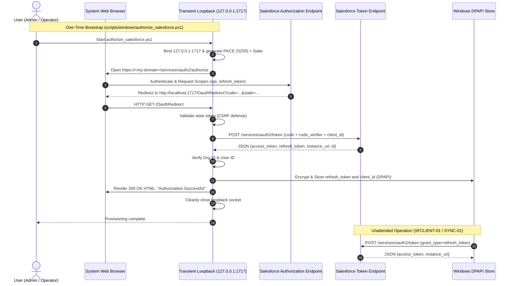

# SF-02 Supporting Document: External Client App Architecture and OAuth Configuration

Document ID: **SF-02-OAUTH**  
Status: **IMPLEMENTED (Metadata Authored & Verified Offline)**  
Observation Date: **01 November 2026**  
Scope: **SF-02-S02 (Prepare the Local ECA Configuration)**  
Direct Requirements: **R08, R14, R15, R16**

---

## 1. Selected Authorization Architecture

Per blueprint §5 and `docs/stories/SF-02.md`, the integration worker utilizes an **External Client App (ECA)** using the **OAuth 2.0 Web Server (Authorization Code) Flow with PKCE (Proof Key for Code Exchange, S256)**, followed by non-interactive refresh-token renewals.



---

## 2. Key Architectural Decisions & Safeguards

### 2.1 External Client App (ECA) over Connected App
Starting in Spring '26, Salesforce restricts new Connected App creation in favor of External Client Apps. Creating `Job_Automation_Client` as an External Client App ensures forward compatibility with Salesforce platform roadmap and avoids reliance on deprecated Connected App APIs.

### 2.2 Proof Key for Code Exchange (PKCE S256)
- **RFC 7636 Compliance**: High-entropy 32-byte `code_verifier` (URL-safe base64, 43 characters) and `code_challenge = BASE64URL(SHA256(code_verifier))`.
- **Public Client Security**: External Client Apps configured for installed native clients set `isConsumerSecretOptional = true` and `isSecretRequiredForRefreshToken = false`. No client secret is distributed, logged, or stored on disk.
- **Code Interception Mitigation**: Even if an authorization code is intercepted, it cannot be exchanged for tokens without the secret `code_verifier`, which resides exclusively in the worker process memory.

### 2.3 Strict Loopback Callback Isolation
- **Exact Callback URL**: `http://localhost:1717/OauthRedirect`.
- **Binding**: Binds strictly to `127.0.0.1:1717` (loopback only; never `0.0.0.0` or external interfaces).
- **Single Request Lifespan**: The loopback receiver accepts exactly one GET request, parses the query parameters, serves a confirmation HTML response to the browser, and closes immediately.
- **Port Contention Check**: The script verifies that port 1717 is free before launching the browser.

### 2.4 Minimally Scoped OAuth Permissions
- **Requested Scopes**:
  - `Api` (`api`): Access and manage data via Salesforce REST API.
  - `RefreshToken` (`refresh_token` / `offline_access`): Issue a refresh token for non-interactive renewals.
- **Explicitly Forbidden / Excluded Scopes**:
  - `Full` (`full`): Blanket administrator access.
  - `Web` (`web`): Interactive browser sessions.
  - `Chatter_Api`: Unnecessary social feeds.
  - `Custom_Permissions`: Unrelated custom permissions.

---

## 3. Metadata Files and Structure

The ECA configuration is declared across four modular metadata components in `salesforce/force-app/main/default/`:

### 3.1 Header: `externalClientApps/Job_Automation_Client.eca-meta.xml`
```xml
<?xml version="1.0" encoding="UTF-8"?>
<ExternalClientApplication xmlns="http://soap.sforce.com/2006/04/metadata">
    <contactEmail>mriteshadak@outlook.com</contactEmail>
    <description>External Client App for personal job search automation worker (SF-02).</description>
    <distributionState>Local</distributionState>
    <isProtected>false</isProtected>
    <label>Job Automation Client</label>
</ExternalClientApplication>
```

### 3.2 OAuth Settings: `extlClntAppOauthSettings/Job_Automation_Client.ecaOauth-meta.xml`
```xml
<?xml version="1.0" encoding="UTF-8"?>
<ExtlClntAppOauthSettings xmlns="http://soap.sforce.com/2006/04/metadata">
    <externalClientApplication>Job_Automation_Client</externalClientApplication>
    <label>Job Automation Client OAuth Settings</label>
    <callbackUrl>http://localhost:1717/OauthRedirect</callbackUrl>
    <isConsumerSecretOptional>true</isConsumerSecretOptional>
    <isIntrospectAllTokens>false</isIntrospectAllTokens>
    <isPkceRequired>true</isPkceRequired>
    <isSecretRequiredForRefreshToken>false</isSecretRequiredForRefreshToken>
    <scopes>Api</scopes>
    <scopes>RefreshToken</scopes>
</ExtlClntAppOauthSettings>
```

### 3.3 Configurable Policies: `extlClntAppOauthPolicies/Job_Automation_Client.ecaOauthPlcy-meta.xml`
```xml
<?xml version="1.0" encoding="UTF-8"?>
<ExtlClntAppOauthConfigurablePolicies xmlns="http://soap.sforce.com/2006/04/metadata">
    <externalClientApplication>Job_Automation_Client</externalClientApplication>
    <label>Job Automation Client Configurable Policies</label>
    <ipRelaxationPolicyType>Enforce</ipRelaxationPolicyType>
    <permittedUsersPolicyType>AdminApprovedPreAuthorized</permittedUsersPolicyType>
    <refreshTokenPolicyType>SpecificLifetime</refreshTokenPolicyType>
    <refreshTokenValidityPeriod>90</refreshTokenValidityPeriod>
    <refreshTokenValidityUnit>Days</refreshTokenValidityUnit>
    <sessionTimeoutInMinutes>15</sessionTimeoutInMinutes>
</ExtlClntAppOauthConfigurablePolicies>
```

### 3.4 Sensitive Global Settings Exclusion
The sensitive metadata file `ExtlClntAppGlobalOauthSettings` (which contains org-generated consumer keys and consumer secrets) is **strictly excluded from source control**. The Consumer Key (Client ID) is provided by the administrator during one-time enrollment and encrypted directly into Windows DPAPI.

