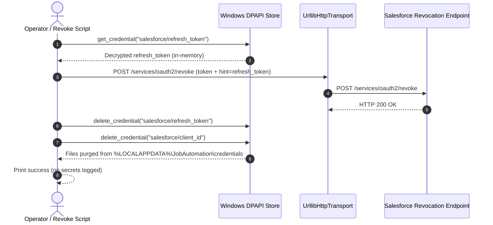

# SF-02 Supporting Document: Token Lifecycle, Renewal, Rotation, Revocation, and Recovery

Document ID: **SF-02-RECOVERY**  
Status: **IMPLEMENTED & VERIFIED OFFLINE**  
Observation Date: **01 November 2026**  
Scope: **SF-02-S05 (Establish Renewal, Rotation, Revocation, and Recovery Procedures)**  
Direct Requirements: **R14, R15, R16**

---

## 1. Token Lifecycle and In-Memory Session Management

The token provider (`OAuthTokenProvider` in `src/job_automation/salesforce/auth.py`) implements deterministic token lifecycle management on native Windows:

### 1.1 In-Memory Caching with Clock Skew
- **Cache**: Stores `SalesforceSession` in process memory (`access_token`, `instance_url`, `issued_at`, `expires_at`).
- **Clock Skew (60 Seconds)**: If `expires_at` is known, the session is reused only if more than 60 seconds remain before expiry:
  ```python
  if now < (session.expires_at - 60.0):
      return session, None
  ```
- **Unknown Expiry**: If Salesforce does not return `expires_in`, the session is reused until an explicit 401 invalid session response triggers invalidation.

### 1.2 Single Renewal on Invalid Session (401)
- If an API request encounters HTTP 401, the cached session is invalidated (`invalidate_session()`) and exactly **one forced renewal** is permitted for that logical operation (`_renewal_count_for_current_call <= 1`).
- If renewal fails or a second 401 occurs within the same call, the worker halts immediately with an `AUTHENTICATION` error (`token_renewal_limit_exceeded`), preventing infinite retry loops or quota exhaustion.

---

## 2. Refresh Token Rotation and Atomic Replacement

When Salesforce External Client Apps are configured with refresh token rotation enabled:
1. Each refresh token exchange returns both a new short-lived `access_token` and a replacement `refresh_token`.
2. **Exchange-In-Progress Marker (`.exchange_pending`)**:
   - Before sending the POST request to `/services/oauth2/token`, the store writes a progress marker file (`<hash>.exchange_pending`) to disk.
   - If transmission fails with an uncertain network timeout, the marker **remains on disk**. On the next startup, the provider detects the marker and refuses to replay the old token (which might have been rotated on the server), raising `interrupted_rotation_recovery_required`.
3. **Atomic File Replacement**:
   - When the replacement refresh token is received, `WindowsDpapiCredentialStore.set_credential()` writes the ciphertext to a temporary file (`.tmp`), flushes and fsyncs the descriptor, and performs an atomic rename via `os.replace()`.
   - The progress marker is deleted only after the replacement token is committed.

---

## 3. Revocation Procedure

Revocation removes remote access tokens from the Salesforce OAuth server and purges encrypted credentials from the local Windows store.

### 3.1 PowerShell Revocation Script
Execute the provided revocation script:
```powershell
& '.\scripts\windows\revoke_salesforce.ps1' -Config 'config\salesforce.json'
```

### 3.2 Programmatic Revocation Flow


### 3.3 Offline Revocation Handling
If the machine is offline or the Salesforce endpoint is unreachable during revocation:
- The local DPAPI credentials (`salesforce/refresh_token` and `salesforce/client_id`) are **immediately deleted from disk**.
- The script outputs a notice:
  ```text
  [NOTICE] Remote token revocation was unreachable or failed, but local DPAPI credentials were removed.
  ```
- The operator is instructed to log into Salesforce Setup (`Setup -> External Client Apps -> Connected / ECA OAuth Usage`) and revoke the specific user grant from the server.

---

## 4. Disaster Recovery and Machine Migration Runbook

| Incident Scenario | Consequence | Recovery Protocol |
|---|---|---|
| **Windows User Account Migration** | DPAPI ciphertext cannot be decrypted under a new Windows SID. | Run `scripts\windows\authorize_salesforce.ps1` under the new Windows account to enroll and establish a fresh DPAPI ciphertext. |
| **Corrupted Credential File** | Decryption fails with Windows error code (e.g. `CryptUnprotectData failed`). | Delete corrupted `.bin` file in `%LOCALAPPDATA%\JobAutomation\credentials\`, re-run `authorize_salesforce.ps1`. |
| **Token Family Invalidation (Reused Rotated Token)** | Salesforce returns `invalid_grant` (`token_family_invalidated`). | Re-run `authorize_salesforce.ps1` to perform interactive PKCE enrollment. Do not attempt to guess or replay old tokens. |
| **Compromised Laptop / Identity** | Potential credential exposure to local administrators. | Log into Salesforce Setup from an administrative workstation and revoke the ECA OAuth grant immediately. |
| **Backup and Restore** | Restoring an old database backup does NOT restore OAuth sessions. | Credentials reside in `%LOCALAPPDATA%\JobAutomation\credentials\`, excluded from ordinary database backups. Re-enrollment is required after a complete system restore. |

