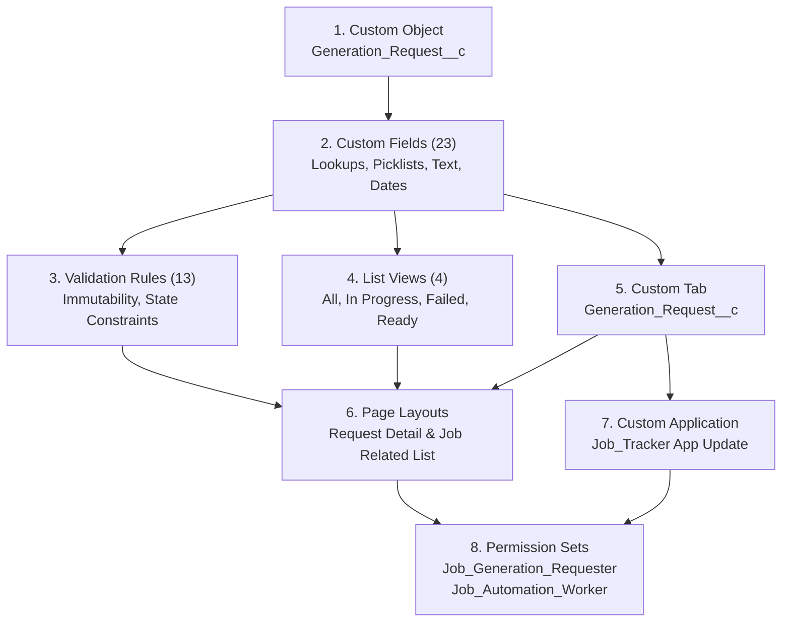

# SF-05 Migration, Deployment & Adoption Plan

Document Reference: `docs/components/SF-05/migration.md`  
Parent Component: [SF-05](../SF-05.md)  
Associated Manifest: `salesforce/manifest/sf05.xml`  
Version: `1.0`  
Date: **01 November 2026**  

---

## 1. Executive Summary

This document specifies the deployment sequence, manifest allowlist, adoption/backfill requirements, and rollback procedures for deploying the `SF-05` metadata (`Generation_Request__c`, layouts, tabs, list views, and permission sets) to the target Salesforce Developer Edition org (`dev-main`).

All deployment operations conform strictly to project rules:
- **Zero Wildcard Manifests**: All members in `salesforce/manifest/sf05.xml` are explicitly enumerated.
- **Additive Evolution**: Additions to `package.xml` and layouts are non-destructive to SF-01/SF-02 baseline metadata.
- **Candidate Preservation**: Deletion constraints (`deleteConstraint="Restrict"`) prevent accidental or cascading deletion of candidate-tracked jobs.

---

## 2. Release Sequence & Dependency Order

Salesforce Metadata API requires deploying interdependent components in strict topological order to avoid unresolved reference failures.



### Step 1: Base Custom Object
- Deploys `objects/Generation_Request__c/Generation_Request__c.object-meta.xml`.
- Establishes `sharingModel = Private`, AutoNumber `Name` pattern `GR-{000000}`, and base object metadata.

### Step 2: Custom Fields (23 items)
- Deploys all 23 custom fields in `objects/Generation_Request__c/fields/`.
- Crucial dependency: `Job__c.field-meta.xml` references `Job__c` custom object (deployed in SF-01).
- Self-referencing dependency: `Predecessor_Request__c.field-meta.xml` references `Generation_Request__c`.

### Step 3: Validation Rules (13 items)
- Deploys all 13 validation rules in `objects/Generation_Request__c/validationRules/`.
- Requires all custom fields to exist before formulas can be parsed by the platform compiler.

### Step 4: List Views (4 items)
- Deploys `All_Requests`, `In_Progress`, `Failed_Requests`, and `Ready_Requests` in `objects/Generation_Request__c/listViews/`.
- Requires custom fields (`Status__c`, `Job__c`, `Document_Type__c`, etc.) to be present.

### Step 5: Custom Tab
- Deploys `tabs/Generation_Request__c.tab-meta.xml` with standard icon motif `Custom20: Fax`.

### Step 6: Page Layouts
- Deploys `layouts/Generation_Request__c-JA Generation Request Detail.layout-meta.xml` (the full 6-section detail page).
- Deploys updated `layouts/Job__c-JA Candidate Tracking.layout-meta.xml` (adding the `Generation_Requests` related list).

### Step 7: Custom Application
- Deploys updated `applications/Job_Tracker.app-meta.xml` to include `<tabs>Generation_Request__c</tabs>`.

### Step 8: Permission Sets
- Deploys new `permissionsets/Job_Generation_Requester.permissionset-meta.xml`.
- Deploys updated `permissionsets/Job_Automation_Worker.permissionset-meta.xml` granting worker access to operational fields.

---

## 3. Scoped Deployment Manifest (`sf05.xml`)

The dedicated manifest `salesforce/manifest/sf05.xml` contains the complete, explicit inventory of SF-05 members without wildcards:

```xml
<?xml version="1.0" encoding="UTF-8"?>
<Package xmlns="http://soap.sforce.com/2006/04/metadata">
    <types>
        <members>Job_Tracker</members>
        <name>CustomApplication</name>
    </types>
    <types>
        <members>Generation_Request__c</members>
        <name>CustomObject</name>
    </types>
    <types>
        <members>Generation_Request__c.Allow_Unavailable_Job__c</members>
        <members>Generation_Request__c.Client_Request_Key__c</members>
        <members>Generation_Request__c.Completed_At__c</members>
        <members>Generation_Request__c.Context_Strategy__c</members>
        <members>Generation_Request__c.Contract_Schema_Version__c</members>
        <members>Generation_Request__c.Document_Type__c</members>
        <members>Generation_Request__c.Error_Category__c</members>
        <members>Generation_Request__c.Error_Message__c</members>
        <members>Generation_Request__c.Error_Reason__c</members>
        <members>Generation_Request__c.Error_Ref__c</members>
        <members>Generation_Request__c.Frozen_Policy_Version__c</members>
        <members>Generation_Request__c.Frozen_Posting_Revision__c</members>
        <members>Generation_Request__c.Frozen_Profile_Version__c</members>
        <members>Generation_Request__c.Frozen_Template_Version__c</members>
        <members>Generation_Request__c.Job__c</members>
        <members>Generation_Request__c.Language__c</members>
        <members>Generation_Request__c.Local_Artifact_Ref__c</members>
        <members>Generation_Request__c.Operation_Marker__c</members>
        <members>Generation_Request__c.Predecessor_Request__c</members>
        <members>Generation_Request__c.Result_Artifact_Ref__c</members>
        <members>Generation_Request__c.Status__c</members>
        <members>Generation_Request__c.Template_Id__c</members>
        <members>Generation_Request__c.Worker_Claimed_At__c</members>
        <name>CustomField</name>
    </types>
    <types>
        <members>Generation_Request__c.Claim_Requires_Claimed_At_And_Versions</members>
        <members>Generation_Request__c.Claimed_At_Not_Before_Created</members>
        <members>Generation_Request__c.Client_Request_Key_Immutable</members>
        <members>Generation_Request__c.Client_Request_Key_No_Whitespace</members>
        <members>Generation_Request__c.Completed_At_Not_Before_Claimed</members>
        <members>Generation_Request__c.Completed_At_Not_Before_Created</members>
        <members>Generation_Request__c.Failed_Requires_Completion_And_Error</members>
        <members>Generation_Request__c.Frozen_Versions_Immutable</members>
        <members>Generation_Request__c.Immutable_Creation_Inputs</members>
        <members>Generation_Request__c.Job_Required</members>
        <members>Generation_Request__c.No_Self_Predecessor</members>
        <members>Generation_Request__c.Ready_Requires_Completion_And_Result</members>
        <members>Generation_Request__c.Template_Id_Required</members>
        <name>ValidationRule</name>
    </types>
    <types>
        <members>Generation_Request__c.All_Requests</members>
        <members>Generation_Request__c.Failed_Requests</members>
        <members>Generation_Request__c.In_Progress</members>
        <members>Generation_Request__c.Ready_Requests</members>
        <name>ListView</name>
    </types>
    <types>
        <members>Generation_Request__c</members>
        <name>CustomTab</name>
    </types>
    <types>
        <members>Generation_Request__c-JA Generation Request Detail</members>
        <members>Job__c-JA Candidate Tracking</members>
        <name>Layout</name>
    </types>
    <types>
        <members>Job_Automation_Worker</members>
        <members>Job_Generation_Requester</members>
        <name>PermissionSet</name>
    </types>
    <version>62.0</version>
</Package>
```

---

## 4. Adoption & Backfill Policy

### 4.1 Greenfield Deployment (Dev-Main Target)
- The target org already contains SF-01 (`Job__c`, `Company__c`) and SF-02 authorization components.
- No existing records exist for `Generation_Request__c`.
- **Zero Backfill Required**: Historical `Job__c` records require no backfill. Generation requests are created on-demand by the candidate or future external producers.

### 4.2 Creation Defaults & Invariants
- All new UI-created records receive:
  - `Contract_Schema_Version__c = "1.0"`
  - `Document_Type__c = "cv"`
  - `Language__c = "de"`
  - `Template_Id__c = "default"`
  - `Context_Strategy__c = "json"`
  - `Allow_Unavailable_Job__c = false`
  - `Status__c = "Pending"`
  - `Client_Request_Key__c = null` (optional for UI)
  - `Predecessor_Request__c = null`

---

## 5. Rollback & Uninstallation Plan

If uninstallation or complete rollback of SF-05 is ever required:

### 5.1 Deletion Safeguards
- Because `Job__c` lookup has `deleteConstraint="Restrict"`, removing `Generation_Request__c` **cannot** cascade or delete any parent `Job__c` or `Company__c` records.
- Deleting `Generation_Request__c` metadata requires deleting child `Generation_Request__c` records first.

### 5.2 Rollback Steps (Reverse Dependency Order)
1. Unassign `Job_Generation_Requester` permission set from users.
2. Revert `Job_Automation_Worker` permission set to the SF-02 baseline (removing `Generation_Request__c` permissions).
3. Remove `<tabs>Generation_Request__c</tabs>` from `Job_Tracker.app-meta.xml`.
4. Revert `Job__c-JA Candidate Tracking.layout-meta.xml` to remove the `Generation_Requests` related list.
5. Delete `Generation_Request__c` custom tab.
6. Delete all `Generation_Request__c` records in the org.
7. Delete `Generation_Request__c` custom object and all custom fields/validation rules via destructive manifest (`destructiveChanges.xml`).

