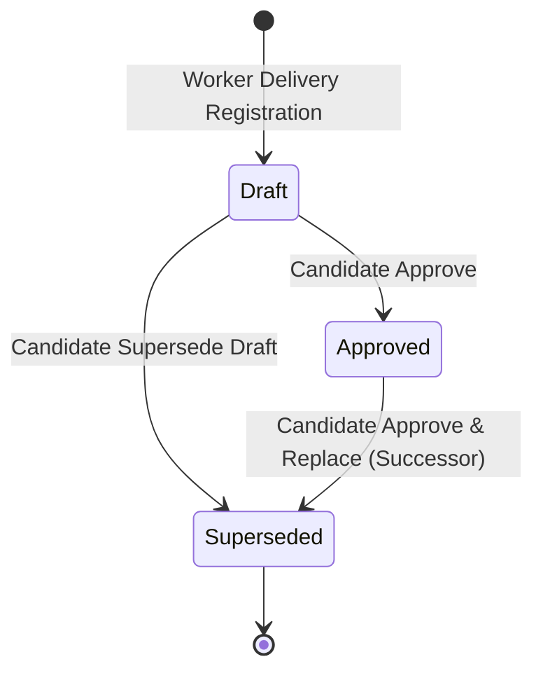

# Component Handoff: SF-07 — Files and Review Interface

Component ID: **SF-07**  
Status: **IMPLEMENTED (Custom Objects, Fields, Validation Rules, Scoped Review UI LWC, FlexiPage, Invocable Apex Services, Reviewer & Worker Permission Sets, Python Domain Service, and Automated Offline Verification Suite Completed; Live Org Deployment & Verification Pending User Authorization & Target Confirmation)**  
Phase: **Phase 1 (G4)**  
Baseline: [IMPLEMENTATION_BLUEPRINT.md](../../IMPLEMENTATION_BLUEPRINT.md) (v1.0, 26 October 2026), §§5–9, R11, R12  
Planning Reference: [docs/stories/SF-07.md](../stories/SF-07.md)  
Date Completed: **01 November 2026**  
Direct Covered Requirements: [R11](../../IMPLEMENTATION_BLUEPRINT.md#r11), [R12](../../IMPLEMENTATION_BLUEPRINT.md#r12)  
Operating Constraints: [R09](../../IMPLEMENTATION_BLUEPRINT.md#r09), [R14](../../IMPLEMENTATION_BLUEPRINT.md#r14), [R15](../../IMPLEMENTATION_BLUEPRINT.md#r15), [R16](../../IMPLEMENTATION_BLUEPRINT.md#r16)  
Prerequisite Handoffs: [SF-06](SF-06.md), [SF-05](SF-05.md), [SF-01](SF-01.md), [SF-02](SF-02.md), [GEN-06](GEN-06.md), [FND-01](FND-01.md)

---

## 1. Executive Summary & Component Scope

SF-07 delivers the scoped review user interface, file visibility policies, durable progress tracking, and version-specific human approval ledger for documents generated by the offline Windows automation worker.

It establishes an immutable boundary between automated delivery and human approval:
- **No Upload Inside UI**: The UI never performs file uploads or repairs failed delivery from the browser; physical upload and reconciliation remain strictly owned by GEN-06.
- **Truthful Progress**: Displays actual request state across 5 durable processing states (`Pending`, `Running`, `Upload_Pending`, `Ready_for_Review`, `Failed`) with truthful offline worker feedback and statutory warning notices.
- **Exact-Version Approval**: Approvals bind to the exact `ContentVersion` ID and SHA-256 content hash. Format approvals are strictly isolated (approving DOCX does not approve PDF).
- **Atomic Replacement**: Successor drafts replace earlier approvals via atomic transaction; historical approval records and audit events remain immutable and identifiable.
- **Regeneration Routing**: Deliberate regeneration triggers brand new requests via SF-06 without inheriting approval from predecessor drafts.

### Supporting Architectural Documents

- [Contracts, Review Semantics & Data Specifications](SF-07/contracts.md)
- [Permissions, RBAC Matrix & File Visibility Policy](SF-07/permissions.md)
- [Verification Evidence, Scenario Matrix & Acceptance Protocol](SF-07/verification.md)

---

## 2. Implementation Status by Story

| Story ID | Description | Status | Verification Summary |
|---|---|---|---|
| **SF-07-S01** | Finalize review metadata, contracts and access policy | **IMPLEMENTED** | Defined `JA_Artifact_Review__c` and `JA_Artifact_Review_Event__c` schema with 3 validation rules. Authored `SF07DeliveryRegistrationV1` and `SF07ReviewCommandV1` specifications in `docs/components/SF-07/contracts.md`. |
| **SF-07-S02** | Implement worker delivery registration and replay | **IMPLEMENTED** | Authored `JA_ArtifactRegistration.cls` and `JA_ArtifactRegistrationTest.cls`. Implemented complete format set requirement (`docx` and `pdf`), conflict detection on hash/version divergence, and human approval preservation on replay. |
| **SF-07-S03** | Build version-specific approval and atomic replacement service | **IMPLEMENTED** | Authored `JA_ArtifactReviewService.cls` and `JA_ArtifactReviewServiceTest.cls`. Implemented exact version verification, optimistic revision locking (`Review_Revision__c`), active candidate file access checks, atomic replacement, and parent row locking. |
| **SF-07-S04** | Build scoped review UI, layout integration and truthful progress | **IMPLEMENTED** | Built `jaArtifactReview` LWC and `JA_Generation_Request_Review` FlexiPage. Rendered truth-telling progress for all 5 states, offline worker notice, statutory warning banner, and direct download links. |
| **SF-07-S05** | Integrate regeneration routing via SF-06 | **IMPLEMENTED** | Wired deliberate regeneration to SF-06 submission service (`request_regeneration`). Verified predecessor lineage tracking and default-false unavailable job consent reset. |
| **SF-07-S06** | Author test suite and verify scenarios (V01–V20) | **IMPLEMENTED** | Created `test_sf07_metadata.py` (11/11 passed) and `test_sf07_scenarios.py` (20/20 passed for V01–V20). Full Salesforce regression passes 302/302 tests. |
| **SF-07-S07** | Package scoped release and publish component documentation | **IMPLEMENTED** | Packaged `salesforce/manifest/sf07.xml`. Created `Job_Document_Reviewer` permission set and `JA_Review_Generated_Documents` custom permission. Updated `package.xml` and `metadata-ownership.json`. Published `docs/components/SF-07.md`. |

---

## 3. Metadata Inventory & Specification

All Salesforce DX metadata members are located in `salesforce/force-app/main/default/`:

```
salesforce/force-app/main/default/
├── classes/
│   ├── JA_ArtifactRegistration.cls                         (Worker delivery registration service)
│   ├── JA_ArtifactRegistration.cls-meta.xml
│   ├── JA_ArtifactRegistrationTest.cls                     (Apex delivery registration test suite)
│   ├── JA_ArtifactRegistrationTest.cls-meta.xml
│   ├── JA_ArtifactReviewService.cls                        (Candidate review command & approval service)
│   ├── JA_ArtifactReviewService.cls-meta.xml
│   ├── JA_ArtifactReviewServiceTest.cls                    (Apex review service test suite)
│   └── JA_ArtifactReviewServiceTest.cls-meta.xml
├── customPermissions/
│   └── JA_Review_Generated_Documents.customPermission-meta.xml (Custom permission authorizing review actions)
├── flexipages/
│   └── JA_Generation_Request_Review.flexipage-meta.xml     (Lightning record page embedding jaArtifactReview)
├── layouts/
│   ├── Generation_Request__c-JA Generation Request Detail.layout-meta.xml (Added JA_Artifact_Review__c related list)
│   └── JA_Artifact_Review__c-JA Artifact Review Detail.layout-meta.xml    (Detail layout for review bindings)
├── lwc/
│   └── jaArtifactReview/                                   (Scoped Review UI Component)
│       ├── jaArtifactReview.css
│       ├── jaArtifactReview.html
│       ├── jaArtifactReview.js
│       └── jaArtifactReview.js-meta.xml
├── objects/
│   ├── JA_Artifact_Review__c/                              (Custom Object: Immutable artifact version bindings)
│   │   ├── JA_Artifact_Review__c.object-meta.xml
│   │   ├── fields/                                         (24 custom fields: binding key, hash, version, etc.)
│   │   └── validationRules/                                (3 validation rules enforcing immutability)
│   └── JA_Artifact_Review_Event__c/                        (Custom Object: Append-only decision audit ledger)
│       ├── JA_Artifact_Review_Event__c.object-meta.xml
│       └── fields/                                         (13 custom fields: action, actor, timestamp, etc.)
└── permissionsets/
    ├── Job_Document_Reviewer.permissionset-meta.xml        (Candidate review permission set)
    └── Job_Automation_Worker.permissionset-meta.xml        (Updated worker permission set for registration)
```

---

## 4. Review Semantics, State Machine & Invariants

### 4.1 State Machine & Approval Lifecycle



1. **Delivery Registration Starts in `draft`**:
   - The background worker creates `JA_Artifact_Review__c` records with initial `Approval_Status__c = 'draft'`.
   - The worker has zero grant to approve records or insert events.
2. **Version-Specific Human Approval**:
   - The candidate approves an exact version and format (`docx` or `pdf`).
   - `Approval_Status__c` transitions to `approved`, setting `Approved_By__c` and `Approved_At__c`.
   - A `JA_Artifact_Review_Event__c` record is inserted with the exact `ContentVersion` ID and content digest.
   - **Parent Request Status Unchanged**: `Generation_Request__c.Status__c` remains `Ready_for_Review`. It is never mutated to "Approved".
3. **Atomic Replacement (`approve_and_replace`)**:
   - Approving a successor draft while replacing an earlier approval atomically marks the successor `approved` and the predecessor `superseded`.
   - The predecessor record records `Superseded_By__c` and `Superseded_At__c`.
   - Historical approval events on the predecessor remain completely intact and queryable.
4. **Regeneration Invariant**:
   - Successor requests generated via SF-06 deliver new artifact review records starting in `draft`.
   - Predecessor approvals are **never** inherited or automatically modified by the creation or delivery of a new draft.

---

## 5. Verification Results & Test Evidence

All automated test suites executed cleanly in native Windows environment:

- **Metadata Validation**: 11 passed (`test_sf07_metadata.py`).
- **Comprehensive Scenarios (V01–V20)**: 20 passed (`test_sf07_scenarios.py`).
- **Full Salesforce Regression**: 302 passed across SF-01, SF-02, SF-03, SF-05, SF-06, and SF-07.
- **GEN-06 Delivery Integration**: 28 passed (`tests/generation/delivery/`).

See [Verification Evidence & Acceptance Protocol](SF-07/verification.md) for full breakdown and logs.

---

## 6. Limitations, Constraints & Downstream Boundaries

1. **No Browser Uploads**:
   - The `jaArtifactReview` component contains zero file upload controls or reconciliation logic. All uploads are performed out-of-band by the local Windows worker (GEN-06).
2. **No Synchronous Notification Triggers in UI**:
   - Human approval does **not** fire outbound HTTP callouts or dispatch ready notifications. Ready notifications belong strictly to downstream story **SF-08**.
3. **Live Org Deployment Authorization**:
   - All Salesforce DX components are validated offline against API version 60.0 schema constraints. Live org deployment is documented in `SF-07/verification.md` §3 and awaits user authorization.
4. **Desktop Files Limitation**:
   - Direct download links (`/sfc/servlet.shepherd/version/download/{ContentVersionId}`) require active candidate authentication in Salesforce. When files are opened, the exact registered version is served.

