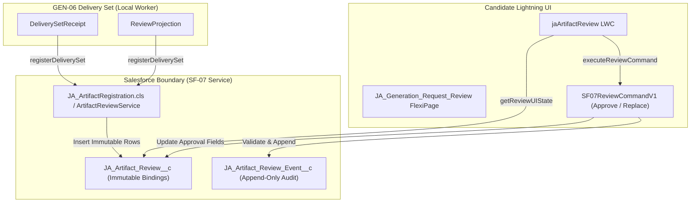

# SF-07 Contracts, Review Semantics & Data Specifications

Component ID: **SF-07**  
Baseline: [IMPLEMENTATION_BLUEPRINT.md](../../../IMPLEMENTATION_BLUEPRINT.md) (v1.0, 26 October 2026), §§5–9, R11, R12  
Planning Reference: [docs/stories/SF-07.md](../../stories/SF-07.md)  
Handoff Reference: [docs/components/SF-07.md](../SF-07.md)

---

## 1. Overview & Architectural Boundaries

SF-07 establishes the formal contracts for:
1. **Delivery Set Registration (`SF07DeliveryRegistrationV1`)**: The worker-to-Salesforce boundary that registers immutable artifact bindings (`JA_Artifact_Review__c`) from sealed GEN-06 `DeliverySetReceipt` and `ReviewProjection` packages.
2. **Candidate Review Command (`SF07ReviewCommandV1`)**: The candidate-to-Salesforce boundary that executes version-specific approval, atomic replacement, and supersession through `JA_ArtifactReviewService`.
3. **Review UI State Projection (`ReviewUIState`)**: The truth-telling presentation contract consumed by the `jaArtifactReview` Lightning Web Component.



---

## 2. Delivery Registration Contract (`SF07DeliveryRegistrationV1`)

Worker delivery registration transforms sealed GEN-06 delivery receipts into immutable Salesforce `JA_Artifact_Review__c` records.

### 2.1 Input Data Specification

| Attribute | Type | Description | Invariant / Validation Rule |
|---|---|---|---|
| `receipt.set_id` | UUID | ArtifactSet UUID | Immutable identity of the generation run. |
| `receipt.set_version` | Integer | Version of the artifact set | Must match the version registered in GEN-06. |
| `receipt.required_formats` | List[String] | Formats required for completeness | Must contain both `docx` and `pdf`. Missing format rejects the set. |
| `receipt.mappings` | Map[String, RemoteArtifactMapping] | Mapping per format (`docx`, `pdf`) | Must exactly match `required_formats`. |
| `mapping.content_document_id`| ID (15/18) | Salesforce ContentDocument ID | Validated against target org. |
| `mapping.content_version_id` | ID (15/18) | Exact ContentVersion ID | Immutable. Never resolves to generic "latest". |
| `mapping.content_hash` | String | SHA-256 (`sha256:<hex>`) | Verifies byte integrity before registration. |
| `mapping.marker` | String | Reconciliation Marker | Grammar: `gen06:v1:<req_uuid>:<art_uuid>:<ver>`. |
| `projection.review_warnings` | List[String] | Pipeline warnings | Formatted into `Safe_Warnings__c`. |
| `projection.semantic_limits_notice` | String | Statutory disclaimer | Rendered permanently on the review record. |

### 2.2 Binding Key Invariant

Every record is keyed deterministically by:
$$\text{BindingKey} = \text{OrgId} : \text{TargetRequestId} : \text{ArtifactId} : \text{ArtifactVersion} : \text{Format}$$

- **Format Isolation**: DOCX and PDF have distinct binding keys and independent review records. Approving DOCX does **not** approve PDF.
- **Idempotent Replay**: Re-registration of the exact same binding key with identical hash and version references preserves the existing record without altering `Approval_Status__c`, `Approved_By__c`, or `Approved_At__c`.
- **Conflict Rejection**: A re-registration with mismatched content hash or remote IDs for an existing binding key is rejected as a data corruption conflict.
- **Initial State**: Newly registered records strictly start in `draft` status. The worker cannot set approval fields.

---

## 3. Candidate Review Command Contract (`SF07ReviewCommandV1`)

Candidate approval, replacement, and supersession actions are submitted as atomic command payloads.

### 3.1 Command Payload Schema

```json
{
  "action": "approve | approve_and_replace | supersede",
  "selectedReviewId": "a03000000000001AAA",
  "expectedVersionId": "068000000000001AAA",
  "expectedContentHash": "sha256:e3b0c44298fc1c149afbf4c8996fb92427ae41e4649b934ca495991b7852b855",
  "expectedReviewRevision": 1,
  "replacedReviewId": "a03000000000002AAA",
  "candidateNotes": "Optional candidate review remarks (max 32k)",
  "explicitAcknowledgment": true,
  "intentToken": "uuid-v4-client-token"
}
```

### 3.2 Command Processing Rules & Concurrency Invariants

1. **Role Separation**:
   - Only users with the custom permission `JA_Review_Generated_Documents` can execute review commands.
   - Background worker principals (`Job_Automation_Worker`) are strictly prohibited from approving drafts or authoring candidate notes (`worker_cannot_approve`).
2. **Exact-Version Verification**:
   - The command must supply `expectedVersionId` and `expectedContentHash`. If the target review record has an unexpected version or hash, the command fails with `version_hash_mismatch`.
3. **Optimistic Revision Locking**:
   - The command must match `expectedReviewRevision`. If a concurrent candidate action already bumped `Review_Revision__c`, the submission fails with `stale_revision` (HTTP 409 equivalent), prompting the UI to reload fresh state.
4. **Active Candidate File Access Re-Verification**:
   - At the exact moment of command execution, the service re-verifies that the candidate user currently possesses valid `Viewer` (`ShareType='V'`) access to the underlying `ContentVersion`. If the file was deleted or the link was revoked between page load and button click, the approval is rejected (`file_inaccessible`).
5. **Atomic Replacement (`approve_and_replace`)**:
   - In a single database transaction:
     - The target record transitions to `approved`.
     - The specified `replacedReviewId` transitions to `superseded` with `Superseded_By__c` pointing to the new record and `Superseded_At__c` set to the server timestamp.
     - Two distinct audit events (`JA_Artifact_Review_Event__c`) are appended to the ledger.
6. **Parent Row Locking**:
   - Transactions lock the target `Job__c` row (`SELECT Id FROM Job__c WHERE Id = :jobId FOR UPDATE`) before checking or updating approval state to prevent concurrent approval races across sibling requests.

### 3.3 Idempotency Replay Invariant

The unique submission identity is:
$$\text{EventKey} = \text{CandidateUserId} : \text{IntentToken}$$

- **Identical Replay**: If the same candidate submits an identical command payload with the same token, the system returns `REPLAYED` with the original `eventId` and the current record state.
- **Payload Conflict**: If the same token is submitted with conflicting parameters (e.g., changed notes or target version), the command is rejected with `idempotency_payload_conflict`.

---

## 4. UI View State Contract (`ReviewUIState`)

The LWC component receives a structured, read-only view state projection:

```typescript
interface ReviewUIState {
  requestId: string;
  requestName: string;
  jobId: string;
  jobTitle: string;
  documentType: 'cv' | 'cover_letter';
  language: 'de' | 'en';
  templateId: string;
  requestStatus: 'Pending' | 'Running' | 'Upload_Pending' | 'Ready_for_Review' | 'Failed';
  statusHeadline: string;
  statusDescription: string;
  offlineWorkerNotice: string | null;
  statutoryWarning: string;
  warnings: string[];
  frozenVersions: {
    postingRevision: string;
    profileVersion: string;
    policyVersion: string;
    templateVersion: string;
  };
  cards: {
    docx: FormatReviewCard;
    pdf: FormatReviewCard;
  };
  currentlyApprovedFormatIds: Record<string, string>;
  allFormatsDelivered: boolean;
  canRegenerate: boolean;
  errorMessage: string | null;
  errorReason: string | null;
}

interface FormatReviewCard {
  format: 'docx' | 'pdf';
  reviewId: string | null;
  contentVersionId: string | null;
  contentDocumentId: string | null;
  contentHash: string | null;
  sizeBytes: number | null;
  deliveryStatus: 'delivered' | 'upload_pending' | 'unavailable';
  approvalStatus: 'draft' | 'approved' | 'superseded';
  deliveredAtBerlin: string | null;
  approvedAtBerlin: string | null;
  approvedBy: string | null;
  isAccessible: boolean;
  downloadUrl: string | null;
  canApprove: boolean;
  canApproveAndReplace: boolean;
  canSupersede: boolean;
  accessMessage: string | null;
}
```

### 4.1 Truth-Telling Request State Feedback

| State | Status Headline | Candidate Description | Action Affordance |
|---|---|---|---|
| `Pending` | Queued in Salesforce | Draft request is safely queued and awaiting background worker pickup. | Approval disabled; regeneration available. |
| `Running` | Generation in Progress | Generation pipeline is executing. Frozen input parameters displayed. | Approval disabled; regeneration available. |
| `Upload_Pending` | Files Upload Pending | Artifacts generated; delivery upload or file linking is in progress. | Approval disabled; shows upload pending badge. |
| `Ready_for_Review` (Incomplete/Unverified) | Delivery Incomplete | Delivered files are partially missing or candidate access is unverified. | Approval disabled; displays access warning. |
| `Ready_for_Review` (Complete & Accessible) | Ready for Review | Both DOCX and PDF verified accessible. Direct download enabled. | Version-specific approval and replacement enabled. |
| `Failed` | Generation Failed | Pipeline encountered an unrecoverable failure. Error reason shown. | Shows failure diagnostics; allows regeneration. |

---

## 5. Non-Inheritance of Approval on Regeneration

Deliberate draft regeneration routes through SF-06 (`GenerationSubmissionService` / `JA_Generate_CV` / `JA_Generate_Cover_Letter`).

1. **Brand New Request**: Regeneration creates a new `Generation_Request__c` with a unique AutoNumber (`GR-{000000}`) and links `Predecessor_Request__c`.
2. **Zero Approval Inheritance**:
   - The successor request delivers new artifact bindings that start strictly in `draft` status.
   - Prior approved bindings on the predecessor request **remain approved** until explicitly replaced by the candidate using `approve_and_replace`.
3. **No Automatic Supersession**: Generating a new draft does **not** supersede earlier drafts or invalidate delivered files.
4. **Consent Reset**: `Allow_Unavailable_Job__c` resets strictly to `false` on regeneration; candidate consent must be actively reaffirmed if the job is unavailable.

