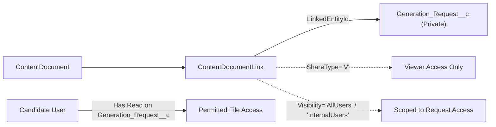

# SF-07 Permissions, RBAC Matrix & File Visibility Policy

Component ID: **SF-07**  
Baseline: [IMPLEMENTATION_BLUEPRINT.md](../../../IMPLEMENTATION_BLUEPRINT.md) (v1.0, 26 October 2026), §§6–8, R11, R12  
Planning Reference: [docs/stories/SF-07.md](../../stories/SF-07.md)  
Handoff Reference: [docs/components/SF-07.md](../SF-07.md)

---

## 1. Principles of Least Privilege & Role Separation

SF-07 enforces strict role separation between the **Human Candidate Reviewer** and the **Automated Worker Process**:

1. **Candidate Reviewer (`Job_Document_Reviewer`)**:
   - Authorized to view requests, delivered files, and review history.
   - Authorized to approve, replace, or supersede specific artifact versions.
   - **Prohibited** from creating or editing `Generation_Request__c` records directly (must use SF-06 submission actions).
   - **Prohibited** from forging worker delivery registrations or directly modifying immutable binding fields on `JA_Artifact_Review__c`.
   - **Prohibited** from creating or modifying `JA_Artifact_Review_Event__c` audit logs outside of the controlled Apex service (`JA_ArtifactReviewService`).
2. **Worker Automation (`Job_Automation_Worker`)**:
   - Authorized to create `JA_Artifact_Review__c` records during delivery registration (`JA_ArtifactRegistration`).
   - Authorized to update request operational completion fields (`Completed_At__c`, `Result_Artifact_Ref__c`, `Status__c`).
   - **Prohibited** from approving drafts, setting `Approval_Status__c = 'approved'`, authoring `Candidate_Notes__c`, or inserting `JA_Artifact_Review_Event__c` records.
   - **Prohibited** from editing candidate tracking fields on `Job__c`.

---

## 2. Permissions Matrix

| Object / Feature | Candidate Reviewer (`Job_Document_Reviewer`) | Worker Automation (`Job_Automation_Worker`) | Standard / Unrelated User |
|---|---|---|---|
| **Custom Permission** `JA_Review_Generated_Documents` | **Granted** | *Not Granted* | *Not Granted* |
| **Apex Class** `JA_ArtifactReviewService` | **Enabled** | *Not Granted* | *Not Granted* |
| **Apex Class** `JA_ArtifactRegistration` | *Not Granted* | **Enabled** | *Not Granted* |
| **Custom Object** `Generation_Request__c` | **Read** (Zero Create, Edit, Delete) | **Read, Edit** (Zero Create, Delete) | No Access |
| **Custom Object** `JA_Artifact_Review__c` | **Read** (Zero Create, Edit, Delete) | **Read, Create** (Zero Edit, Delete) | No Access |
| **Custom Object** `JA_Artifact_Review_Event__c` | **Read** (Zero Create, Edit, Delete) | **Read** (Zero Create, Edit, Delete) | No Access |
| **Custom Object** `Job__c` | **Read** (Candidate Tracking Fields Editable) | **Read** (Zero Edit on Candidate Fields) | No Access |
| **Salesforce Files** (`ContentDocument` / `ContentVersion`) | **Viewer (`ShareType='V'`)** | **Collaborator / Owner** | No Access |

---

## 3. Field-Level Security (FLS) Specification

### 3.1 `JA_Artifact_Review__c` Field Permissions

| Field Name | Type | Candidate Reviewer | Worker Automation | Immutability / Constraint |
|---|---|---|---|---|
| `Binding_Key__c` | Text (255, Unique) | Read-Only | Read-Only (Set on Create) | Immutable after insert. |
| `Generation_Request__c` | Lookup (`Generation_Request__c`) | Read-Only | Read-Only (Set on Create) | Restrict-delete parent lookup. |
| `Org_Id__c` | Text (18) | Read-Only | Read-Only (Set on Create) | Target Salesforce Org ID. |
| `Artifact_Set_Id__c` | Text (36) | Read-Only | Read-Only (Set on Create) | Local ArtifactSet UUID. |
| `Artifact_Id__c` | Text (36) | Read-Only | Read-Only (Set on Create) | Local Artifact UUID. |
| `Artifact_Version__c` | Number (4, 0) | Read-Only | Read-Only (Set on Create) | Local Artifact integer version. |
| `Format__c` | Text (10) | Read-Only | Read-Only (Set on Create) | `docx` or `pdf`. |
| `Content_Hash__c` | Text (71) | Read-Only | Read-Only (Set on Create) | SHA-256 (`sha256:<hex>`). |
| `Size_Bytes__c` | Number (18, 0) | Read-Only | Read-Only (Set on Create) | Size in bytes. |
| `Content_Document_Id__c`| Text (18) | Read-Only | Read-Only (Set on Create) | ContentDocument ID. |
| `Content_Version_Id__c` | Text (18) | Read-Only | Read-Only (Set on Create) | Exact ContentVersion ID. |
| `Reconciliation_Marker__c`| Text (255) | Read-Only | Read-Only (Set on Create) | `gen06:v1:<req>:<art>:<ver>`. |
| `Delivery_Receipt_Ref__c`| Text (255) | Read-Only | Read-Only (Set on Create) | Local DeliverySetReceipt UUID. |
| `Delivered_At__c` | DateTime | Read-Only | Read-Only (Set on Create) | Server UTC delivery timestamp. |
| `Safe_Warnings__c` | LongTextArea (32k) | Read-Only | Read-Only (Set on Create) | Sanitized pipeline warnings. |
| `Predecessor_Binding__c`| Lookup (`JA_Artifact_Review__c`) | Read-Only | Read-Only (Set on Create) | Set-level lineage binding. |
| `Approval_Status__c` | Picklist (`draft`,`approved`,`superseded`) | Read-Only | Read-Only | Modified only via `JA_ArtifactReviewService`. |
| `Review_Revision__c` | Number (9, 0) | Read-Only | Read-Only | Optimistic concurrency revision counter. |
| `Approved_By__c` | Lookup (`User`) | Read-Only | Read-Only | Human candidate who approved. |
| `Approved_At__c` | DateTime | Read-Only | Read-Only | Server timestamp of approval. |
| `Approval_Event_Ref__c` | Text (255) | Read-Only | Read-Only | Reference to `JA_Artifact_Review_Event__c`. |
| `Superseded_By__c` | Lookup (`JA_Artifact_Review__c`) | Read-Only | Read-Only | Successor approved review record. |
| `Superseded_At__c` | DateTime | Read-Only | Read-Only | Server timestamp of supersession. |
| `Contract_Schema_Version__c`| Text (16) | Read-Only | Read-Only (Set on Create) | `1.0`. |

### 3.2 `JA_Artifact_Review_Event__c` Field Permissions

All fields on `JA_Artifact_Review_Event__c` are strictly **Read-Only** for both Candidate and Worker permission sets. Inserts are performed exclusively by the Apex service running in `without sharing` context after authenticating the candidate's custom permission:

- `Event_Key__c`: Unique idempotent event token (`CandidateUserId:IntentToken`).
- `Artifact_Review__c`: Restrict-delete master-detail/lookup to target review record.
- `Action__c`: `approve`, `approve_and_replace`, or `supersede`.
- `Previous_Status__c`, `New_Status__c`: State transition record.
- `Prior_Review_Revision__c`, `New_Review_Revision__c`: Concurrency version delta.
- `Actor__c`: ID of candidate executing the action.
- `Event_Timestamp__c`: Canonical UTC event timestamp.
- `Selected_Content_Version_Id__c`, `Selected_Content_Hash__c`: Immutable proof of approved bytes.
- `Replaced_Artifact_Review__c`: Lineage reference to superseded review record.
- `Candidate_Notes__c`: Candidate justification notes (sanitized, max 32k).

---

## 4. File Visibility & ContentDocumentLink Policy

Delivered artifact files in Salesforce Files must adhere to the following visibility rules:

1. **Linked Entity**:
   - Delivered files are linked directly to the parent `Generation_Request__c` record via `ContentDocumentLink`.
   - Files are **not** linked broadly to `Job__c` by default, preserving request-level isolation and avoiding accidental disclosure across unrelated candidate views.
2. **ShareType**:
   - Set strictly to `V` (Viewer). Candidate reviewers cannot edit, overwrite, or delete delivered ContentDocuments or ContentVersions.
3. **Visibility**:
   - Set to `AllUsers` or `InternalUsers`. Under private record sharing, this grants access only to internal users who possess Read access to the parent `Generation_Request__c`.
4. **Access Verification Gate**:
   - `JA_ArtifactReviewService.verifyCandidateFileAccess` dynamically checks `ContentDocumentLink` and `UserRecordAccess` before rendering download links or accepting approvals.
   - If a link is missing or revoked, the UI displays `unavailable` and disables approval affordances while truthfully preserving historical approval state.

