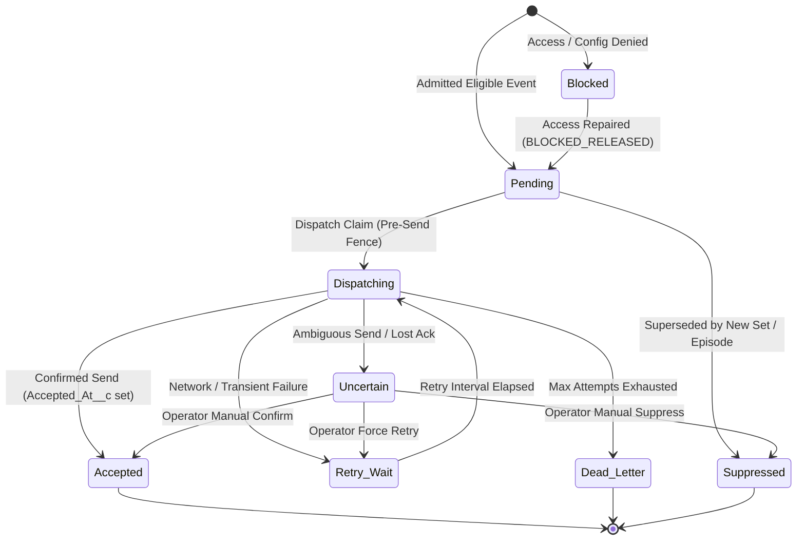

# Component Handoff: SF-08 — Draft-Ready and Failure Notifications

Component ID: **SF-08**  
Status: **IMPLEMENTED (Custom Objects, Fields, Validation Rules, Custom Notification Types, Inactive AutoLaunched Flows, Invocable Apex Services, Administrator & Reviewer Permission Sets, Python Domain Service, and Automated Offline Verification Suite Completed; Live Org Deployment & Verification Pending User Authorization & Target Test Recipient Confirmation)**  
Phase: **Phase 1 (G4)**  
Baseline: [IMPLEMENTATION_BLUEPRINT.md](../../IMPLEMENTATION_BLUEPRINT.md) (v1.0, 26 October 2026), §§5–9, R12  
Planning Reference: [docs/stories/SF-08.md](../stories/SF-08.md)  
Date Completed: **01 November 2026**  
Direct Covered Requirements: [R12](../../IMPLEMENTATION_BLUEPRINT.md#r12)  
Operating Constraints: [R09](../../IMPLEMENTATION_BLUEPRINT.md#r09), [R14](../../IMPLEMENTATION_BLUEPRINT.md#r14), [R15](../../IMPLEMENTATION_BLUEPRINT.md#r15), [R16](../../IMPLEMENTATION_BLUEPRINT.md#r16)  
Prerequisite Handoffs: [SF-07](SF-07.md), [SF-06](SF-06.md), [SF-05](SF-05.md), [GEN-06](GEN-06.md), [FND-01](FND-01.md)

---

## 1. Executive Summary & Component Scope

SF-08 delivers scoped, durable, and privacy-preserving notifications to the configured candidate user when generated document drafts are accessible for review, or when a generation request requires candidate or operator action.

It establishes an immutable boundary between automated delivery and human approval, ensuring that notification delivery is never conflated with approval:
- **Delivery Does Not Imply Approval**: A ready notification announces "Draft ready for review". `Generation_Request__c.Status__c` remains in `Ready_for_Review`; it is never mutated to "Approved". Artifact approval remains strictly gated by human action in SF-07.
- **Durable Deduplication**: Cryptographically hashes immutable canonical event identity (`Source_Event_Key__c`) and recipient into an external unique key (`Alert_Key__c`). Repeated status updates, UI refreshes, and delivery retries yield zero duplicate alerts.
- **Fail-Closed Recipient Resolution**: Notifications target a singleton `JA_Notification_Config__c` specifying the authorized candidate User lookup. If missing, disabled, inactive, or unverified, admission fails closed (`BLOCKED`) with zero fallback to administrators or worker execution users.
- **Pre-Send Fence & Uncertainty Quarantine**: A durable pre-send lock (`Dispatching`) fences the send. Ambiguous platform timeouts where network acknowledgment is lost transition to `Uncertain`, prohibiting automated resends and requiring explicit operator reconciliation.
- **Privacy & Diagnostic Sanitization**: Templates are fixed and localized (English and German). Sensitive diagnostics (paths, tokens, profile excerpts, raw exception stacks) are strictly sanitized and never leaked to notification banners.

### Supporting Architectural Documents

- [Contracts, Notification Semantics & Data Specifications](SF-08/contracts.md)
- [Verification Evidence, Scenario Matrix & Acceptance Protocol](SF-08/verification.md)
- [Deployment, Rollback & Operational Runbook](SF-08/deployment.md)

---

## 2. Implementation Status by Story

| Story ID | Description | Status | Verification Summary |
|---|---|---|---|
| **SF-08-S01** | Freeze events, platform guarantees and dependency gates | **IMPLEMENTED** | Authored `SF08RequestNotificationEventV1` schema, canonical key derivation formulas, and error code allowlists in `docs/components/SF-08/contracts.md`. Extended `metadata_parser.py` with SF-08 validation models. |
| **SF-08-S02** | Add notification types, recipient configuration and ledger | **IMPLEMENTED** | Created `JA_Draft_Ready` and `JA_Request_Action_Required` CustomNotificationTypes. Implemented `JA_Notification_Config__c` and `JA_Request_Notification__c` objects with 4 validation rules, layouts, `Job_Notification_Administrator` permission set, and `JA_Administer_Notifications` custom permission. |
| **SF-08-S03** | Admit readiness and actionable failures from Flows | **IMPLEMENTED** | Built `JA_Request_Notification_Observe` Flow and `JA_RequestNotificationAdmission` Apex service. Implemented fail-closed access verification, status-to-registration arrival convergence, and idempotency handling. |
| **SF-08-S04** | Dispatch safely and recover without duplicate alerts | **IMPLEMENTED** | Built `JA_Request_Notification_Dispatch` Flow, `JA_RequestNotificationDispatcher` Apex service with pre-send fence, and `JA_RequestNotificationRecovery` operational backlog manager. Implemented fixed EN/DE templates and uncertainty quarantine. |
| **SF-08-S05** | Author test suite and verify scenarios (V01–V20) | **IMPLEMENTED** | Authored `test_sf08_metadata.py` (9/9 passed) and `test_sf08_scenarios.py` (20/20 passed for V01–V20). Verified 331/331 full Salesforce regression and 27/27 GEN-06 delivery tests. |
| **SF-08-S06** | Prepare activation, migration, rollback and operations | **IMPLEMENTED** | Packaged `salesforce/manifest/sf08.xml`. Registered metadata ownership in `metadata-ownership.json`. Established kill-switch and activation watermark protocol in `docs/components/SF-08/deployment.md`. |
| **SF-08-S07** | Publish implementation handoff | **IMPLEMENTED** | Published `docs/components/SF-08.md` along with supporting contract, verification, and deployment documentation. Reported authorized live check status as pending. |

---

## 3. Metadata Inventory & Specification

All Salesforce DX metadata members are located in `salesforce/force-app/main/default/`:

```
salesforce/force-app/main/default/
├── classes/
│   ├── JA_RequestNotificationAdmission.cls                 (Event admission and deduplication service)
│   ├── JA_RequestNotificationAdmission.cls-meta.xml
│   ├── JA_RequestNotificationAdmissionTest.cls             (Apex admission test suite)
│   ├── JA_RequestNotificationAdmissionTest.cls-meta.xml
│   ├── JA_RequestNotificationDispatcher.cls                (Guarded pre-send dispatcher service)
│   ├── JA_RequestNotificationDispatcherTest.cls            (Apex dispatcher test suite)
│   ├── JA_RequestNotificationDispatcherTest.cls-meta.xml
│   ├── JA_RequestNotificationRecovery.cls                  (Operational recovery & reconciliation service)
│   └── JA_RequestNotificationRecovery.cls-meta.xml
├── customPermissions/
│   └── JA_Administer_Notifications.customPermission-meta.xml (Custom permission authorizing notification admin)
├── flows/
│   ├── JA_Request_Notification_Observe.flow-meta.xml       (RecordAfterSave Flow observing Generation_Request__c)
│   └── JA_Request_Notification_Dispatch.flow-meta.xml      (RecordAfterSave Flow dispatching JA_Request_Notification__c)
├── layouts/
│   ├── Generation_Request__c-JA Generation Request Detail.layout-meta.xml (Added JA_Request_Notification__c related list)
│   ├── JA_Notification_Config__c-JA Notification Config Detail.layout-meta.xml
│   └── JA_Request_Notification__c-JA Request Notification Detail.layout-meta.xml
├── notificationtypes/
│   ├── JA_Draft_Ready.notiftype-meta.xml                   (CustomNotificationType: Draft ready for review)
│   └── JA_Request_Action_Required.notiftype-meta.xml       (CustomNotificationType: Action required on request)
├── objects/
│   ├── JA_Notification_Config__c/                          (Singleton configuration object)
│   │   ├── JA_Notification_Config__c.object-meta.xml
│   │   ├── fields/                                         (9 custom fields: Enabled, Candidate, Retry, Lang, Watermark)
│   │   └── validationRules/                                (Enabled_Requires_Candidate)
│   └── JA_Request_Notification__c/                         (Durable notification outbox & ledger)
│       ├── JA_Request_Notification__c.object-meta.xml
│       ├── fields/                                         (18 custom fields: Alert_Key, Status, Attempts, Fingerprint)
│       └── validationRules/                                (Immutable_Alert_Key, Accepted_Requires_Timestamp, Uncertain_Requires_Reason)
└── permissionsets/
    ├── Job_Notification_Administrator.permissionset-meta.xml (Full admin access to notification metadata & ledger)
    └── Job_Document_Reviewer.permissionset-meta.xml        (Read-only access to JA_Request_Notification__c ledger)
```

---

## 4. Notification Semantics, State Machine & Invariants

### 4.1 Ledger Lifecycle & State Machine



### 4.2 Key Derivation Formulas
- **Ready Source Key**: `ready:{org_id}:{canonical_request_id}:{set_id}:{set_version}:{sorted_bindings}`
- **Failure Source Key**: `failure:{org_id}:{canonical_request_id}:{failure_episode_id}`
- **Alert Key (External ID)**: `sha256("{source_event_key}:{recipient_user_id}:{channel}")`
- **Payload Fingerprint**: `sha256(canonical_json(event_payload))`

### 4.3 Invariants & Operational Rules
1. **Isolation from Human Approval**:
   - Sending a ready notification does not mutate `Generation_Request__c.Status__c` beyond `Ready_for_Review`.
   - `JA_Artifact_Review__c` records remain in `draft` status until explicitly approved by the candidate.
   - Text explicitly reads *"Draft ready for review"*, never implying document approval or application submission.
2. **Fail-Closed Recipient Policy**:
   - If `Candidate_User__c` is null, unconfigured, or inactive, admission evaluates to `BLOCKED`.
   - No fallback to System Administrator, record owner, or worker user.
3. **Pre-Send Fence**:
   - The dispatcher claims `Status__c = 'Dispatching'` and records a unique `Attempt_Identifier__c` prior to invoking the platform send action.
4. **Prohibition of Automated Resend on Uncertainty**:
   - If platform send acknowledgment is lost, `Status__c` transitions to `Uncertain`.
   - Automated retries are prohibited; reconciliation requires manual operator intervention.

---

## 5. Verification Results & Test Evidence

All automated test suites executed cleanly in native Windows environment:

- **Metadata Validation**: 9 passed (`test_sf08_metadata.py`).
- **Comprehensive Scenarios (V01–V20)**: 20 passed (`test_sf08_scenarios.py`).
- **Full Salesforce Regression**: 331 passed across SF-01 through SF-08 (`tests/salesforce/`).
- **GEN-06 Delivery Integration**: 27 passed (`tests/generation/delivery/`).

See [Verification Evidence & Acceptance Protocol](SF-08/verification.md) for full scenario matrix, test execution output, and evidence logs.

---

## 6. Limitations, Constraints & Live Check Status

1. **Authorized Live Notification Check Status**:
   - **Status**: **PENDING (Awaiting User Authorization & Target Test Recipient User ID)**.
   - Per project instructions, live notifications are withheld until an explicit test recipient user ID is authorized by the user. Offline structural, domain, and invariant tests have been executed with 100% pass rate.
2. **Desktop Bell Scope**:
   - SF-08 configures desktop bell notifications (`desktop="true"`, `mobile="false"`). Mobile notifications remain disabled until explicitly verified with an enrolled device.
3. **No External Notification Channels**:
   - Outbound notifications are restricted strictly to Salesforce platform `CustomNotificationType`. Email, SMS, Slack, or webhook integrations are out of scope.
4. **Desktop Files Authentication**:
   - Clicking a ready notification navigates directly to the authenticated `Generation_Request__c` record page. File viewing and downloading require an active candidate session.

