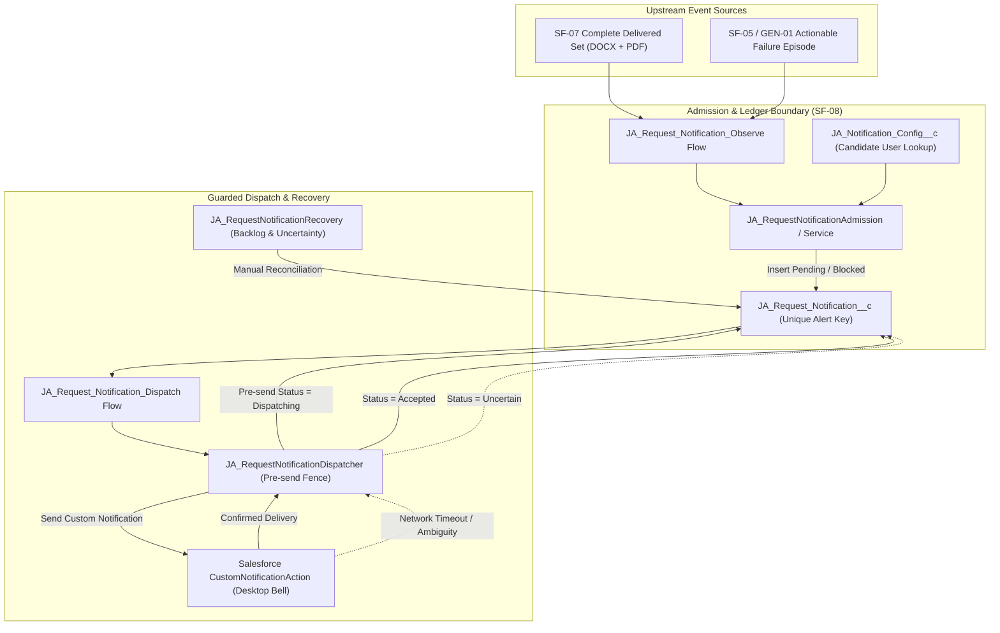
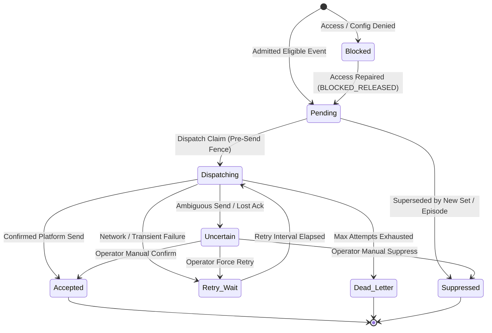

# SF-08 Contracts, Notification Semantics & Data Specifications

Component ID: **SF-08**  
Baseline: [IMPLEMENTATION_BLUEPRINT.md](../../../IMPLEMENTATION_BLUEPRINT.md) (v1.0, 26 October 2026), §§5–9, R12  
Planning Reference: [docs/stories/SF-08.md](../../stories/SF-08.md)  
Handoff Reference: [docs/components/SF-08.md](../SF-08.md)

---

## 1. Overview & Architectural Boundaries

SF-08 establishes formal contracts and data specifications for draft-ready and failure notifications in Salesforce:
1. **Event Admission Contract (`SF08RequestNotificationEventV1`)**: Ingests authoritative request readiness and failure events from upstream components (GEN-06, SF-07, SF-05/GEN-01).
2. **Notification Ledger Model (`JA_Request_Notification__c`)**: Outbox/ledger tracking delivery attempts, idempotency keys, payloads, and states.
3. **Recipient Configuration (`JA_Notification_Config__c`)**: Singleton configuration defining the authorized candidate user, permitted events, language preference, and retry parameters.
4. **Guarded Dispatcher Boundary**: Serialized dispatch with a pre-send fence, platform CustomNotification delivery, and uncertainty quarantine for ambiguous network outcomes.



---

## 2. Event Admission Contract (`SF08RequestNotificationEventV1`)

The admission boundary consumes structured events and derives deterministic keys before writing to the ledger.

### 2.1 Event Envelope Attributes

| Attribute | Type | Description | Invariant / Validation Rule |
|---|---|---|---|
| `schema_version` | String | Schema version identifier | Must equal `"1.0"`. |
| `event_kind` | Enum | Nature of notification | Must be `ready` or `action_required`. |
| `origin_org_id` | String (18) | Salesforce Org 18-char ID | Validated against current execution org. |
| `request_id` | String (18) | Target `Generation_Request__c.Id` | Must exist and be accessible to candidate. |
| `request_uuid` | UUID | Local generation request UUID | Monotonic link to local worker database. |
| `request_number` | String | Request auto-number (e.g., `REQ-000101`) | Used in notification templates. |
| `source_revision` | Integer | Monotonic projection revision | Rejects admissions where `source_revision < existing`. |
| `payload` | Object | Event-specific payload details | Validated against kind-specific schema. |

---

### 2.2 Ready Event Payload (`ReadyEventPayload`)

| Attribute | Type | Description | Invariant / Validation Rule |
|---|---|---|---|
| `artifact_set_id` | UUID | Set identity from GEN-05/GEN-06 | Immutable identity of generated package. |
| `artifact_set_version` | Integer | Version of artifact set | Monotonically increasing set version. |
| `required_formats` | List[String] | Formats required for completeness | Must contain both `docx` and `pdf`. |
| `bindings` | Map[String, ReviewBindingInfo] | Format to ContentVersion and hash | Must provide valid entries for all required formats. |
| `recipient_access_verified` | Boolean | Access proof under SF-07 policy | Must be `True`. If `False`, admission is `BLOCKED`. |

---

### 2.3 Failure Event Payload (`FailureEventPayload`)

| Attribute | Type | Description | Invariant / Validation Rule |
|---|---|---|---|
| `failure_episode_id` | UUID | Durable episode identity | Must be non-null. Created once upon failure entry. |
| `is_terminal` | Boolean | Whether request entered `Failed` | Terminal failure or explicit intervention. |
| `is_intervention_required` | Boolean | Explicit delivery blockage | Required if request is in `Upload_Pending`. |
| `action_code` | String | Allowlisted action/reason code | e.g. `job_unavailable`, `capacity_exhausted`. |
| `safe_diagnostic_summary` | String | Sanitized non-sensitive error text | Strict sanitization: no paths, tokens, or PII. |

---

## 3. Deterministic Identity & Key Formulas

To prevent duplicate notifications across repeated updates, status cycles, retries, and worker restarts, SF-08 computes cryptographic keys over immutable canonical fields:

### 3.1 Ready Event Source Key
```text
ready:{org_id}:{canonical_request_id}:{set_id}:{set_version}:{sorted_bindings}
```
Where `sorted_bindings` is the semicolon-delimited concatenation of sorted formats:
```text
docx={cv_id}:{hash};pdf={cv_id}:{hash}
```
*Invariants*:
- Excludes timestamps, receipt UUIDs, retry attempts, and approval statuses.
- Distinct artifact sets or versions generate distinct keys.
- Replays with identical bindings yield the exact same source key.

### 3.2 Failure Event Source Key
```text
failure:{org_id}:{canonical_request_id}:{failure_episode_id}
```
*Invariants*:
- Key is tied strictly to the durable `failure_episode_id`.
- Replaying `Failed -> Running -> Failed` without a newly issued episode preserves the existing key.

### 3.3 Unique Alert Key (Ledger External ID)
```text
Alert_Key__c = sha256("{source_event_key}:{recipient_user_id}:{channel}")
```
- Length: 64 hexadecimal characters.
- Stored as an External ID (`unique="true"`, `caseSensitive="true"`).
- Guarantees exactly one alert per source event, recipient, and channel at the database schema level.

### 3.4 Payload Fingerprint
```text
Payload_Fingerprint__c = sha256(canonical_json(event_payload))
```
- Used for conflict detection: if an incoming event matches an existing `Alert_Key__c` but has a differing `Payload_Fingerprint__c`, the admission is quarantined as `CONFLICT`.

---

## 4. Recipient Configuration & Resolution Policy

1. **Singleton Configuration**: Defined in `JA_Notification_Config__c` with `Org_Key__c = OrgId`.
2. **Fail-Closed Resolution**:
   - If no config record exists $\to$ `outcome = BLOCKED`, code `CONFIG_DISABLED`.
   - If `Is_Enabled__c == False` $\to$ `outcome = BLOCKED`, code `CONFIG_DISABLED`.
   - If `Candidate_User__c == null` $\to$ `outcome = BLOCKED`, code `RECIPIENT_NOT_CONFIGURED`.
   - If candidate user is inactive $\to$ `outcome = BLOCKED`, code `RECIPIENT_INACTIVE`.
   - If candidate user lacks read access to the request or files $\to$ `outcome = BLOCKED`, code `RECIPIENT_ACCESS_DENIED`.
3. **Strict Role Separation**:
   - Zero fallback to System Administrator, record owner, or worker execution user.
   - The recipient is snapshot at admission time on `JA_Request_Notification__c.Recipient_User__c`.

---

## 5. Notification Templates & Safe Localization

SF-08 provides deterministic, fixed localized templates in English (`en`) and German (`de`). Document language does not dictate notification language; the candidate's `Preferred_Language__c` in `JA_Notification_Config__c` is used.

### 5.1 Template Catalog

| Event Kind | Action Code | Language | Notification Title | Notification Body |
|---|---|---|---|---|
| `ready` | `N/A` | `en` | `Draft ready for review` | `Request {requestNumber}: DOCX and PDF drafts are available. Open the request to review them.` |
| `ready` | `N/A` | `de` | `Entwurf bereit zur Prüfung` | `Antrag {requestNumber}: DOCX- und PDF-Entwürfe stehen zur Verfügung. Öffnen Sie den Antrag zur Prüfung.` |
| `action_required` | `job_unavailable` | `en` | `Draft request needs attention` | `Request {requestNumber}: Selected job is no longer available. Open the request for details.` |
| `action_required` | `job_unavailable` | `de` | `Antrag erfordert Aufmerksamkeit` | `Antrag {requestNumber}: Die gewählte Stelle ist nicht mehr verfügbar. Öffnen Sie den Antrag für Details.` |
| `action_required` | `delivery_intervention` | `en` | `Draft delivery needs attention` | `Request {requestNumber}: file delivery is blocked. Open the request for the next step.` |
| `action_required` | `delivery_intervention` | `de` | `Dokumentübertragung erfordert Aufmerksamkeit` | `Antrag {requestNumber}: Dateiübertragung blockiert. Öffnen Sie den Antrag für den nächsten Schritt.` |
| `action_required` | Generic / Other | `en` | `Draft request needs attention` | `Request {requestNumber} could not complete. Open the request for the next step.` |
| `action_required` | Generic / Other | `de` | `Antrag erfordert Aufmerksamkeit` | `Antrag {requestNumber} konnte nicht abgeschlossen werden. Öffnen Sie den Antrag für den nächsten Schritt.` |

### 5.2 Content & Navigation Constraints
- **Title Length Limit**: Max 250 characters.
- **Body Length Limit**: Max 750 characters.
- **Target Navigation**: Validated record ID of `Generation_Request__c` (`Target_Record_Id__c`).
- **No Sensitive Leakage**: Alert text contains **only** the validated request number. Never contains job descriptions, employer names, candidate names, stack traces, local file paths, or raw exception strings.
- **Delivery Does Not Imply Approval**: The notification text states "Draft ready for review" and **never** "Approved", "Accepted", or "Submitted".

---

## 6. Safe Diagnostic Sanitization Policy

Any diagnostic text stored in `Safe_Error_Code__c` or operational logs must pass `sanitize_diagnostic_text()`:
1. Strips OAuth tokens, bearer tokens, and session IDs (`/bearer\s+[a-z0-9_\-\.]+/i`).
2. Strips local Windows/POSIX file paths (`[A-Za-z]:\\[^ \n]+`, `/home/[^ \n]+`).
3. Strips candidate profile details and URLs (`https?://[^\s]+`).
4. Strips raw HTML and script tags (`<[^>]+>`).
5. Only allowlisted error codes are stored in `Safe_Error_Code__c`.

---

## 7. Dispatch Lifecycle, Pre-Send Fence & Uncertainty Protocol



### 7.1 Pre-Send Fence
Before invoking the platform notification API:
1. Dispatcher claims the record by setting `Status__c = 'Dispatching'`, updating `Attempts__c`, `Attempt_Identifier__c = uuid()`, and timestamping `Dispatched_At__c`.
2. This claim is committed to the database.
3. If the process crashes or network drops after this point, the attempt identifier prevents duplicate concurrent execution.

### 7.2 Handling Ambiguous Outcomes (`Uncertain`)
- If an unhandled timeout or network fault occurs where the dispatch service cannot confirm whether the platform delivered the alert (e.g. `AmbiguousSendError`, `TimeoutError`), the record transitions to `Status__c = 'Uncertain'`.
- **Automated Resend is Prohibited**: No automated retry or background worker may re-dispatch an `Uncertain` record.
- **Operator Reconciliation**: The administrator must reconcile the record via `confirm_accepted()`, `suppress()`, or `force_retry()`.

