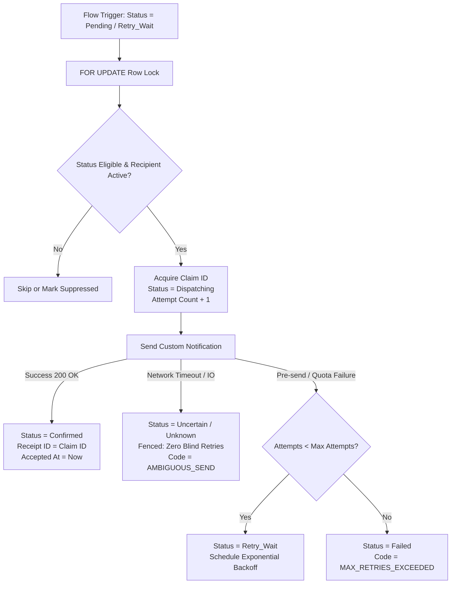

# Component Handoff: SF-09 — Run-Summary Notification Target

Component ID: **SF-09**  
Status: **IMPLEMENTED (Custom Object, 47 Custom Fields, 6 Validation Rules, 3 List Views, Custom Tab, Detail Layout, Custom Notification Type, Inactive AutoLaunched Flow, Apex Guard & Dispatcher Services, Worker/Reader/Admin Scoped Permission Sets, Python Domain Service, and Automated Offline Verification Suite Completed; Live Org Deployment & Live Notification Verification Pending User Authorization & Target Test Recipient Confirmation)**  
Phase: **Phase 2 (G5)**  
Baseline: [IMPLEMENTATION_BLUEPRINT.md](../../IMPLEMENTATION_BLUEPRINT.md) (v1.0, 26 October 2026), C15 and §§5–10, R17  
Planning Reference: [docs/stories/SF-09.md](../stories/SF-09.md)  
Date Completed: **01 November 2026**  
Direct Covered Requirements: [R17](../../IMPLEMENTATION_BLUEPRINT.md#r17) (Deterministic automation and completion visibility)  
Supporting Operating Constraints: [R09](../../IMPLEMENTATION_BLUEPRINT.md#r09) (Local durable processing state), [R14](../../IMPLEMENTATION_BLUEPRINT.md#r14) (Native Windows compatibility), [R15](../../IMPLEMENTATION_BLUEPRINT.md#r15) (Diagnostic privacy and credential safety), [R16](../../IMPLEMENTATION_BLUEPRINT.md#r16) (Auditability, bounded retries, and recovery)  
Prerequisite Handoffs: [SF-01](SF-01.md), [FND-01](FND-01.md), [SF-02](SF-02.md), [SF-04](SF-04.md), [AUTO-03](AUTO-03.md)

---

## 1. Executive Summary & Component Scope

SF-09 delivers the version-controlled Salesforce target schema, unique run identity, scoped permissions, and completion-notification Flow for search pipeline execution summaries.

It establishes an immutable boundary between automated pipeline execution, summary ingestion, and candidate notification:
- **Single Completion Entitlement**: Exactly one completion notification entitlement is granted per logical run (`run_id`), keyed canonically by `{org_id}:{run_id}`.
- **Immutable First Snapshot vs Mutable Latest Results**: On the first trustworthy terminal result (`success`, `partial`, `failed`), initial outcome metrics (`First_*`) and completion timestamp (`Completion_Recorded_At__c`) are frozen permanently. Subsequent same-run resumes or corrected updates advance monotonic `Revision__c` and update latest metrics silently without rearming the remote notification Flow.
- **Durable Pre-Send Fence**: Pre-send mutual exclusion acquires a unique attempt claim (`Notification_Claim_Id__c`) and sets state to `dispatching`. Ambiguous platform network timeouts fence into `unknown`, prohibiting automated resends and preventing duplicate candidate alerts.
- **Local Diagnostic Privacy**: Verbose stack traces, local paths, and bearer tokens stay local in SQLite; only bounded, sanitized plain text is projected to Salesforce.
- **Truthful Outcomes**: "No postings found" is used **only** when completed source coverage proves zero observations were returned across configured job boards. Observed duplicates or updates with zero new jobs report "No new jobs".
- **Scoped Least-Privilege Permissions**: Integration workers have Read/Create/Edit authority on delivery fields, while server-managed lifecycle markers (`Completion_Recorded_At__c`, `First_*`, `Notification_*`) are strictly read-only for worker identities.

### Supporting Architectural Documents

- [Schema Mapping, Field Ownership & Projection Contract](SF-09/mapping.md)
- [Contracts, Deduplication Semantics & Dispatch State Machine](SF-09/contracts.md)
- [Deployment, Migration, Rollback & Operational Runbook](SF-09/deployment.md)

---

## 2. Implementation Status by Story

| Story ID | Description | Status | Verification Summary |
|---|---|---|---|
| **SF-09-S01** | Freeze the remote contract and dispatch feasibility | **IMPLEMENTED** | Reconciled 1.0/1.1 projection mappings, frozen first-snapshot transfer, and serialized claim protocol in `SF-09/contracts.md` and `SF-09/mapping.md`. |
| **SF-09-S02** | Implement the compact record and immutable completion identity | **IMPLEMENTED** | Authored `Run_Summary__c` custom object, 47 custom fields, 6 validation rules, 3 list views, tab, and layout. Enforced lowercase UUID External ID and immutable `First_Completion_Key__c`. |
| **SF-09-S03** | Implement the completion-notification Flow and recovery guard | **IMPLEMENTED** | Built `JA_Run_Completed` CustomNotificationType, `JA_Run_Summary_Completion` Flow (inactive `Draft`), and `JA_RunSummaryGuard`, `JA_RunSummaryDispatcher`, and `JA_RunSummaryRecovery` Apex services. |
| **SF-09-S04** | Define least-privilege access and controlled activation | **IMPLEMENTED** | Implemented `Job_Summary_Worker`, `Job_Summary_Reader`, and `Job_Summary_Administrator` permission sets. Verified worker cannot modify server completion/notification markers. |
| **SF-09-S05** | Verify duplicate-upsert and AUTO-03 integration behavior | **IMPLEMENTED** | Authored `test_sf09_metadata.py` (9/9 passed) and `test_sf09_scenarios.py` (16/16 passed for T01–T16). Full Salesforce regression passed (356/356). AUTO-03 delivery tests passed (44/44). |
| **SF-09-S06** | Package deployment, recovery and the component handoff | **IMPLEMENTED** | Authored `salesforce/manifest/sf09.xml`. Updated `package.xml` and `metadata-ownership.json`. Established kill-switch and activation watermark protocol in `SF-09/deployment.md`. |

---

## 3. Metadata Inventory & Specification

All Salesforce DX metadata members are located in `salesforce/force-app/main/default/`:

```
salesforce/force-app/main/default/
├── classes/
│   ├── JA_RunSummaryGuard.cls                  (Admission, revision ordering, and first snapshot guard)
│   ├── JA_RunSummaryGuard.cls-meta.xml
│   ├── JA_RunSummaryGuardTest.cls              (Apex guard test suite)
│   ├── JA_RunSummaryGuardTest.cls-meta.xml
│   ├── JA_RunSummaryDispatcher.cls             (Guarded pre-send dispatcher with claim lock)
│   ├── JA_RunSummaryDispatcherTest.cls         (Apex dispatcher test suite)
│   ├── JA_RunSummaryDispatcherTest.cls-meta.xml
│   ├── JA_RunSummaryRecovery.cls               (Operational retry, reconciliation & suppression)
│   └── JA_RunSummaryRecoveryTest.cls           (Apex recovery test suite)
├── flows/
│   └── JA_Run_Summary_Completion.flow-meta.xml (RecordAfterSave AutoLaunchedFlow on Run_Summary__c, status: Draft)
├── layouts/
│   └── Run_Summary__c-Run Summary Layout.layout-meta.xml (Comprehensive sectioned layout)
├── notificationtypes/
│   └── JA_Run_Completed.notiftype-meta.xml     (CustomNotificationType: Run completed, desktop only)
├── objects/
│   └── Run_Summary__c/
│       ├── Run_Summary__c.object-meta.xml      (Private custom object with Text Name field)
│       ├── fields/                             (47 custom fields: Run_Id, First_*, Notification_*, Counters)
│       ├── listViews/                          (All_Run_Summaries, Failed_Or_Partial_Runs, Unresolved_Notifications)
│       └── validationRules/                    (6 rules: Immutable_Run_Id, Immutable_Key, Duration, Receipts)
├── permissionsets/
│   ├── Job_Summary_Worker.permissionset-meta.xml (Scoped worker: Read/Create/Edit, server fields read-only)
│   ├── Job_Summary_Reader.permissionset-meta.xml (Candidate reader: Read-only, Tab visible)
│   └── Job_Summary_Administrator.permissionset-meta.xml (Operator admin: Class access, Recovery permissions)
└── tabs/
    └── Run_Summary__c.tab-meta.xml             (CustomTab: Custom53 Bell)
```

---

## 4. Outcome Categories, Deduplication & Pre-Send Fence

### 4.1 Four Core Run Outcomes

| Outcome Category | Pipeline Status | Headline Semantics | Notification Alert |
|---|---|---|---|
| **Nonempty Success** | `success` | Discovered postings and created/updated canonical jobs | Alert links to summary; displays observed count, new jobs, duplicates. |
| **Empty Success** | `success` | "No postings found" **only** if coverage complete and observations = 0 | Alert links to summary; clarifies complete source search with 0 postings. |
| **Partial Run** | `partial` | "Search partial" with identified failed sources/stages | Alert links to summary; highlights safe error digest and pending work. |
| **Failed Run** | `failed` | "Search failed" with actionable diagnostics | Alert links to standalone summary with error reason; no Job record required. |

### 4.2 Deduplication Rules & Revision Ordering

1. **Replay of Identical Revision**:
   - Monotonic revision `Revision__c` matches existing.
   - Payload hash `Payload_Hash__c` matches existing.
   - Result: Successful idempotent no-op. Server markers (`Completion_Recorded_At__c`, `Notification_Status__c`, `Notification_Receipt_Id__c`) remain unchanged; zero duplicate alerts.
2. **Revision Conflict**:
   - `Revision__c` matches existing, but `Payload_Hash__c` differs.
   - Result: Rejected with `RunSummaryRevisionConflictError`. Prevents silent data tampering.
3. **Stale Revision**:
   - Incoming `Revision__c` is lower than already applied `Revision__c`.
   - Result: Rejected with `RunSummaryStaleRevisionError`.
4. **Resumed Run (Higher Revision)**:
   - Incoming `Revision__c > existing.Revision__c`.
   - Result: Latest-result fields update. `First_*` snapshots, `Completion_Recorded_At__c`, and `Notification_Status__c` remain frozen. No second completion alert is generated.

### 4.3 Pre-Send Fence & Uncertainty Quarantine



---

## 5. Verification Results & Test Evidence

All automated test suites executed cleanly on native Windows:

- **SF-09 Metadata & Structural Suite**: 9 passed (`tests/salesforce/metadata/test_sf09_metadata.py`).
  * Verified CustomNotificationType desktop/mobile flags.
  * Verified custom object sharing model and Text Name field.
  * Verified all 47 fields, data types, external IDs, uniqueness, and required constraints.
  * Verified all 6 validation rules, 3 list views, layout, and tab.
  * Verified Flow processType and initial Draft status.
  * Verified worker, reader, and admin permission sets.
  * Verified `sf09.xml`, `package.xml`, and `metadata-ownership.json`.
- **SF-09 Acceptance Matrix Scenarios (T01–T16)**: 16 passed (`tests/salesforce/metadata/test_sf09_scenarios.py`).
  * T01: Nonempty success, empty success, duplicate-only success, zero eligible verified.
  * T02: Partial and failed runs verified with truthful headlines.
  * T03: Running states create zero completion entitlement.
  * T04: 10 repeated initial payload upserts result in exactly 1 entitlement and 1 dispatch invocation.
  * T05: Lost HTTP response reconciliation query by External ID verified.
  * T06: Thread safety and serialized attempt claim under concurrency verified.
  * T07: Failed -> Success resume preserves initial failed snapshot and delayed alert text.
  * T08: Stale revisions and revision conflicts rejected.
  * T09: Distinct run UUIDs grant independent entitlements.
  * T10: Missing recipient and disabled configuration fail-closed.
  * T11: Ambiguous network timeout fences in `unknown` without automated resend.
  * T12: Confirmed status never rearms on status re-entry.
  * T13: Scoped worker, reader, and admin permission boundaries verified.
  * T14: Diagnostic secret scrubbing and local path sanitization verified.
  * T15: Historical import suppression prior to watermark verified.
  * T16: AUTO-03 adapter integration compatibility verified.
- **Full Salesforce Package Regression**: 356 passed (`tests/salesforce/`).
- **AUTO-03 Summary Delivery Regression**: 44 passed (`tests/orchestration/summary_delivery/`).

---

## 6. Deployment, Rollback & Operational Protocol

1. **Scoped Deployment**:
   - Deploy `salesforce/manifest/sf09.xml` using Salesforce CLI (`sf project deploy start --manifest salesforce/manifest/sf09.xml`).
2. **Inactive Flow Guarantee**:
   - `JA_Run_Summary_Completion` is deployed with `<status>Draft</status>` (inactive).
3. **Singleton Configuration & Activation Watermark**:
   - Populate `JA_Notification_Config__c` with `Is_Enabled__c = true`, `Candidate_User__c = <User_Id>`, and `Activation_Watermark__c = System.now()` (protects against historical back-notification storms).
4. **Emergency Deactivation**:
   - Setting `JA_Notification_Config__c.Is_Enabled__c = false` halts all notification dispatches immediately.
   - Deactivating `JA_Run_Summary_Completion` Flow in Setup disables trigger processing.
   - **Never delete `Run_Summary__c` records**: Run summaries maintain deduplication identity; deleting them destroys completion evidence.

---

## 7. Limitations, Constraints & Live Check Status

1. **Authorized Live Notification Check Status**:
   - **Status**: **PENDING (Awaiting User Authorization & Target Test Recipient User ID)**.
   - Per project instructions, live notifications are withheld until an explicit test recipient user ID is authorized by the user. Offline structural, domain, and invariant tests have been executed with 100% pass rate.
2. **Desktop Bell Scope**:
   - SF-09 configures desktop bell notifications (`desktop="true"`, `mobile="false"`). Mobile notifications remain disabled until explicitly verified with an enrolled device.
3. **No External Notification Channels**:
   - Outbound notifications are restricted strictly to Salesforce platform `CustomNotificationType`. Email, SMS, Slack, or webhook integrations are out of scope.
4. **Decoupled Pipeline Exit Code**:
   - A notification dispatch failure or unknown state **never** changes the pipeline process exit code; exit code `0` is preserved for successful searches.
5. **Remaining Phase 2 Gate Integration**:
   - Gate G5 remains pending until joint end-to-end integration between AUTO-03 summary delivery worker and live Salesforce target is executed with authorized credentials.

