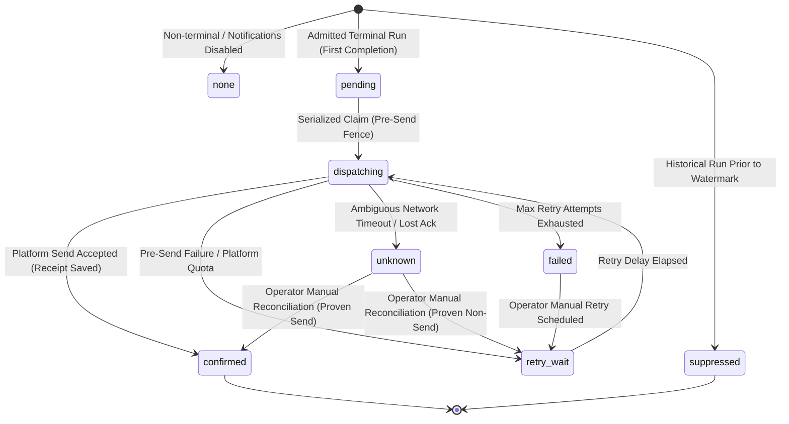

# SF-09 Contracts, Deduplication Semantics & Dispatch State Machine

Component ID: **SF-09**  
Baseline: [IMPLEMENTATION_BLUEPRINT.md](../../../IMPLEMENTATION_BLUEPRINT.md), C15 and §§5–10, R17  
Handoff Reference: [docs/components/SF-09.md](../SF-09.md)  
Planning Reference: [docs/stories/SF-09.md](../../stories/SF-09.md)

---

## 1. Notification Lifecycle & State Machine

The delivery state of `Run_Summary__c` progresses through a strictly fenced state machine:

### State Definitions

1. `none`:
   - Non-terminal run status or notification delivery disabled in `JA_Notification_Config__c`.
   - Zero dispatch attempts executed.
2. `pending`:
   - First terminal completion admitted for an enabled active candidate recipient.
   - Ready for processing by `JA_Run_Summary_Completion` Flow.
3. `dispatching`:
   - Pre-send fence locked with unique `Notification_Claim_Id__c` and incremented attempt count.
   - Mutual exclusion prevents concurrent dispatchers from sending duplicate alerts.
4. `confirmed`:
   - Platform custom notification delivery succeeded.
   - `Notification_Receipt_Id__c` and `Notification_Accepted_At__c` are permanently recorded.
   - **Never rearms** on subsequent updates, same-revision replays, or higher-revision resumes.
5. `retry_wait`:
   - Retryable pre-send failure (e.g. temporary API error).
   - Scheduled for exponential backoff: `1 * (2 ^ (attempt - 1))` minutes.
6. `unknown`:
   - Ambiguous outcome (e.g. network timeout after send request was transmitted).
   - Fenced: automated retries are strictly prohibited to prevent duplicate candidate alerts.
   - Requires operator investigation and reconciliation via `JA_RunSummaryRecovery`.
7. `failed`:
   - Max retry attempts (default 3) exhausted or unrecoverable error (e.g. missing recipient).
   - Inspectable on `Unresolved_Notifications` list view.
8. `suppressed`:
   - Runs completed prior to `Activation_Watermark__c` or historical batch imports.

---

## 2. Fixed Bilingual Templates & Diagnostic Privacy

All notification content is strictly bounded and localized based on `JA_Notification_Config__c.Preferred_Language__c`:
- **Title Bound**: Max 250 characters.
- **Body Bound**: Max 750 characters.
- **Diagnostic Sanitization**: Sensitive credentials, bearer tokens, OAuth session IDs, and Windows/POSIX file paths are scrubbed using regex patterns before projection or notification formatting.

### 2.1 English Templates (`Preferred_Language__c = 'en'`)

| Outcome Category | Condition | Notification Title | Notification Body |
|---|---|---|---|
| **Nonempty Success** | `Pipeline_Status__c = 'success'`, `Source_Postings_Count__c > 0`, `Canonical_Jobs_New__c > 0` | `Run Completed: Success` | `Run {run_id}: {headline}\nObserved: {obs} postings | Jobs: +{new} new, {upd} updated, {dup} duplicate.\nCompleted at {time_berlin}.` |
| **Empty Success** | `Pipeline_Status__c = 'success'`, `Source_Postings_Count__c = 0`, `Coverage_Status__c = 'complete'` | `Run Completed: No postings found` | `Run {run_id}: No postings found across configured sources.\nCompleted at {time_berlin}.` |
| **Duplicate-Only Success** | `Pipeline_Status__c = 'success'`, `Source_Postings_Count__c > 0`, `Canonical_Jobs_New__c = 0` | `Run Completed: No new jobs` | `Run {run_id}: {headline}\nObserved: {obs} postings (+0 new, {upd} updated, {dup} duplicate).\nCompleted at {time_berlin}.` |
| **Partial Run** | `Pipeline_Status__c = 'partial'` | `Run Completed: Partial` | `Run {run_id}: Search partial with incomplete source coverage.\nSafe error digest: {error_summary}\nCompleted at {time_berlin}.` |
| **Failed Run** | `Pipeline_Status__c = 'failed'` | `Run Completed: Failed` | `Run {run_id}: Search failed before completion.\nSafe error digest: {error_summary}\nCompleted at {time_berlin}.` |

### 2.2 German Templates (`Preferred_Language__c = 'de'`)

| Outcome Category | Condition | Notification Title | Notification Body |
|---|---|---|---|
| **Nonempty Success** | `Pipeline_Status__c = 'success'`, `obs > 0`, `new > 0` | `Suchlauf abgeschlossen: Erfolgreich` | `Lauf {run_id}: {headline}\nGefunden: {obs} Ausschreibungen | Stellen: +{new} neu, {upd} aktualisiert, {dup} Duplikate.\nAbgeschlossen um {time_berlin}.` |
| **Empty Success** | `Pipeline_Status__c = 'success'`, `obs = 0`, `complete` | `Suchlauf abgeschlossen: Keine Ausschreibungen` | `Lauf {run_id}: Keine Ausschreibungen in konfigurierten Quellen gefunden.\nAbgeschlossen um {time_berlin}.` |
| **Duplicate-Only Success**| `Pipeline_Status__c = 'success'`, `obs > 0`, `new = 0` | `Suchlauf abgeschlossen: Keine neuen Stellen` | `Lauf {run_id}: {headline}\nGefunden: {obs} Ausschreibungen (+0 neue, {upd} aktualisiert, {dup} Duplikate).\nAbgeschlossen um {time_berlin}.` |
| **Partial Run** | `Pipeline_Status__c = 'partial'` | `Suchlauf unvollständig: Teilweise` | `Lauf {run_id}: Suche mit unvollständiger Quellenabdeckung beendet.\nFehler: {error_summary}\nAbgeschlossen um {time_berlin}.` |
| **Failed Run** | `Pipeline_Status__c = 'failed'` | `Suchlauf fehlgeschlagen: Fehler` | `Lauf {run_id}: Suche vor dem Abschluss fehlgeschlagen.\nFehler: {error_summary}\nAbgeschlossen um {time_berlin}.` |

---

## 3. Truthful Headline Invariants

1. **"No postings found"**:
   - Used **only** when `Coverage_Status__c = 'complete'` AND `Source_Postings_Count__c = 0`.
   - If sources failed or coverage was partial, the headline must state `Search partial` or `Search failed`.
2. **"No new jobs"**:
   - Used when postings were observed (`Source_Postings_Count__c > 0`) but all were duplicates or updates (`Canonical_Jobs_New__c = 0`).
3. **Zero Eligible Jobs**:
   - Discovered postings that were evaluated as `Rejected` or `Review` do **not** constitute an empty search; they are reported as successful searches with zero eligible jobs.

